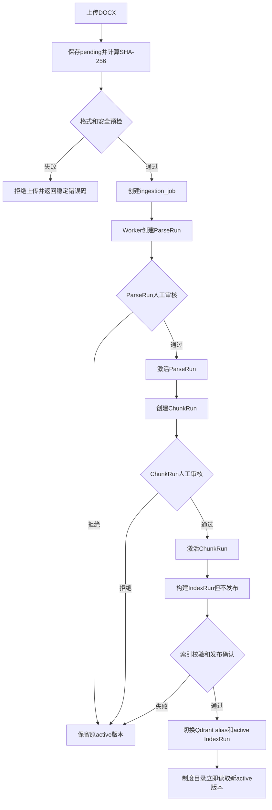

# 文档处理与制度入库模块规划

> 文件说明：本文件审查知识模块迁移方案与当前 `policy-platform` 工程结构、既有设计规划的
> 一致性，并给出后续开发DOCX上传、解析、审核、分块和索引发布功能的最小实现思路。
> 知识模块迁移和第二期基础链路已经实现。当前问答运行边界以 ADR-0004 为准：Platform
> 通过进程内 `KnowledgeService` 调用 `RagRuntime`，不再依赖独立 8010 服务。

## 1. 审查结论

已实施的迁移方案适合现有项目，也适合作为后续文档处理模块的基础。

方案与现有工程的核心兼容点如下：

| 当前结构或规划 | 迁移后的处理 | 结论 |
|---|---|---|
| `backend/app` 已按API、application、domain、infrastructure、schemas分层 | 保持不动 | 兼容 |
| `backend/app/api/dependencies.py` 集中装配服务 | 注入进程内 `KnowledgeService` 与Platform应用服务 | 兼容 |
| Platform使用FastAPI和SQLAlchemy | 继续负责页面API和Platform业务数据 | 兼容 |
| 知识库使用原生SQLite、Qdrant和模型客户端 | 放入平级 `backend/knowledge` | 兼容 |
| V2规划第二期增加上传、后台任务和人工审核 | 在统一知识服务上增加job和Worker | 兼容 |
| 已有latest/active运行指针 | 原样保留 | 必须保留 |
| 已有Qdrant版本化collection和alias | 原样保留 | 必须保留 |
| 现有制度列表依赖Platform投影 | 改由 `KnowledgeCatalogService` 读取active数据 | 已完成 |
| 现有问答曾依赖8010 HTTP客户端 | 改为进程内服务边界，保留 `rag_api_v1_1` 结果语义 | 已完成 |
| 当前PDF来自 `backend/document_files` | 改读 `var/knowledge/pdf` | 已完成 |
| 当前三段Platform迁移 | 压缩为一个最终基线 | 适合本机测试项目 |

需要明确的是：管理侧解析、审核、分块、索引编排和在线问答都保留在本工程。应用层只通过
`KnowledgeService` 使用进程内Runtime，不直接操作知识SQLite、Qdrant客户端或模型客户端。
该边界不改变以下领域规则：

- 原始文件不可覆盖；
- ParseRun、ChunkRun和IndexRun分别审核与激活；
- latest不能自动替代active；
- Qdrant alias只在正式发布时切换；
- Citation保存回答当时的证据快照；
- 文档处理不能在普通Web请求中长时间同步执行。

因此，本轮已更新ADR、PROJECT_HANDOFF和V2设计文档，当前事实源不再保留相互冲突的运行说明。

## 2. 模块定位

迁移后的后端分为两个平级模块：

```text
backend/app
  └─ 产品功能：用户、聊天、反馈、管理API、任务编排

backend/knowledge
  └─ 管理能力：解析、审核、分块、索引、active制度目录
```

`app` 的问答服务只调用 `knowledge.service.KnowledgeService`；管理服务可以调用 `knowledge.management` 和
`knowledge.catalog`。API路由不直接导入知识数据库、Qdrant或模型客户端。具体约束为：

```text
允许：app.application.chat_service -> knowledge.service
允许：app.application.document_service -> knowledge.catalog
允许：worker -> knowledge.management

禁止：app.api -> knowledge.parser.database
禁止：app.api -> knowledge.indexing.qdrant_store
禁止：app.api -> knowledge.rag.generator
```

这样既保持一个项目、一套后端启动方式，也避免路由层直接操纵解析表和active指针。

## 3. 推荐代码结构

```text
backend/
├─ app/
│  ├─ api/v1/
│  │  ├─ documents.py             # 普通用户制度查询
│  │  └─ admin_documents.py       # 后续管理端上传和审核API
│  ├─ application/
│  │  ├─ chat_service.py
│  │  ├─ document_service.py
│  │  └─ ingestion_service.py     # 后续任务编排，不做解析算法
│  ├─ infrastructure/db/
│  ├─ schemas/
│  ├─ config.py
│  └─ main.py
│
├─ knowledge/
│  ├─ __init__.py
│  ├─ config.py
│  ├─ contracts.py
│  ├─ catalog.py                  # 只读active制度、Node和PDF
│  ├─ service.py                  # 兼容导出，不作为进程内问答Runtime
│  ├─ cli.py
│  ├─ parser/
│  │  ├─ ooxml.py
│  │  ├─ analyzer.py
│  │  ├─ render.py
│  │  ├─ pipeline.py
│  │  ├─ review.py
│  │  └─ database.py
│  ├─ chunking/
│  │  ├─ chunker.py
│  │  └─ review.py
│  ├─ indexing/
│  │  ├─ config.py
│  │  ├─ database.py
│  │  ├─ embedding.py
│  │  ├─ indexer.py
│  │  └─ qdrant_store.py
│  ├─ retrieval/
│  │  ├─ retriever.py
│  │  ├─ reranker.py
│  │  └─ rerank_retriever.py
│  └─ rag/
│     ├─ runtime.py
│     ├─ pipeline.py
│     ├─ context_builder.py
│     ├─ citation.py
│     ├─ generator.py
│     ├─ quality_gate.py
│     └─ 其余必要实现
│
├─ migrations/
└─ tests/
```

该结构与当前工程兼容，因为Python测试配置已经将 `backend` 加入导入路径，`app` 和
`knowledge` 可以作为两个平级包加载，无需新增工作区或单独Python项目。

## 4. 运行时装配

### 4.1 KnowledgeService生命周期

FastAPI lifespan 创建可复用的 `KnowledgeService`，但不立即初始化RagRuntime、Qdrant客户端或
模型客户端。首次问答在专用单线程中惰性创建Runtime，停止时在同一线程释放资源：

```text
FastAPI启动
  ↓
创建KnowledgeService
  ↓
读取知识库、Qdrant和模型服务配置
  ↓
保存到app.state
  ↓
依赖函数从app.state获取同一实例
  ↓
FastAPI停止时释放资源
```

当前 `app/api/dependencies.py` 从 `app.state` 读取该服务，不需要引入依赖注入框架。

### 4.2 配置

Platform配置：

```text
PLATFORM_DATABASE_URL
PLATFORM_KNOWLEDGE_DATA_ROOT
```

Platform Web进程的所有文件路径以 `PLATFORM_KNOWLEDGE_DATA_ROOT` 为根解析；知识CLI可用
`POLICY_KNOWLEDGE_DATA_ROOT` 覆盖同一目录。数据库中保存相对路径，避免依赖当前工作目录。

## 5. 数据与文件边界

### 5.1 Platform数据库

`platform.db` 保存产品业务数据：

- 用户和角色；
- 会话和消息；
- Citation历史快照；
- 反馈和诊断；
- 后续的ingestion job、事件和审核任务；
- 管理操作审计。

原 Platform 测试数据已丢弃，并通过 `0001_unified_platform_baseline.py` 从空库创建。

文档处理功能开始开发时增加：

```text
0002_document_ingestion_jobs.py
```

该迁移只增加Platform任务编排表，不复制Node、Chunk或Run表。

### 5.2 知识数据库

`policy_parser.db` 保存知识处理事实：

- `policy_document`；
- ParseRun及解析阶段；
- SourceBlock和Node；
- ParseRun审核记录；
- ChunkRun、Chunk和来源映射；
- Chunk审核记录；
- IndexRun和active索引指针。

这些数据由 `knowledge` 模块内部维护。Platform管理API只能通过服务方法触发审核和激活。

### 5.3 文件目录

迁移后的基础目录：

```text
var/knowledge/
├─ policy_parser.db
├─ source_documents/              # 已接收的原始DOCX
├─ accepted/                      # 接受修订后的DOCX
└─ pdf/                           # 与ParseRun绑定的PDF
```

开发上传功能后再增加：

```text
var/knowledge/
├─ pending/                       # 尚未正式接收的上传文件
└─ temp/                          # 可安全清理的处理中间文件
```

上传先在内存中完成格式与安全校验，未通过的内容不写入受控目录。已落盘任务的后续失败由
`IngestionJob.state=FAILED`、`failed_stage`、错误码和对应Run状态统一表达，不维护第二套文件隔离状态。

## 6. 文档处理状态机

后续模块建议使用以下完整链路：



任何步骤失败都不修改上一版active ParseRun、ChunkRun、IndexRun和Qdrant alias。

## 7. 第一阶段：先提供服务和CLI

迁移完成时只需要提供可复用服务：

```python
class KnowledgeService:
    def query(self, question: str): ...
    def import_document(self, path): ...
    def parse_document(self, document_id: int): ...
    def review_parse_run(self, run_id: int, decision): ...
    def build_chunks(self, parse_run_id: int): ...
    def review_chunk_run(self, run_id: int, decision): ...
    def build_index(self, *, activate: bool = False): ...
    def activate_index(self, index_run_id: int): ...
```

CLI只负责解析参数和打印进度，不包含业务逻辑。这样以后管理页面和Worker可以直接调用同一组服务。

迁移阶段不开发：

- 上传页面；
- job表；
- Worker轮询；
- 审核工作台；
- 失败任务自动重试。

这些功能后续增加时不会要求再次搬迁解析、Chunk和索引代码。

## 8. 第二阶段：管理API和单Worker

需要页面上传和查看进度时，在 `platform.db` 增加：

### 8.1 `ingestion_job`

建议字段：

- `id`
- `document_id`
- `job_type`
- `status`
- `progress_current`
- `progress_total`
- `current_stage`
- `parse_run_id`
- `chunk_run_id`
- `index_run_id`
- `error_code`
- `error_message`
- `created_by`
- `created_at`
- `started_at`
- `finished_at`

### 8.2 `ingestion_job_event`

记录阶段变化和进度，用于页面展示，不复制知识数据库中的解析正文。

### 8.3 `review_assignment`

记录：

- 审核类型；
- 对应Run ID；
- 审核人；
- 审核状态；
- 审核意见；
- 创建和完成时间。

知识数据库继续保存正式审核结果；Platform表用于页面任务和操作审计。

### 8.4 Worker

本机测试阶段只启用一个Worker进程：

```powershell
D:\3-anaconda\envs\py312\python.exe -m app.workers.ingestion
```

Worker从 `platform.db` 领取任务，然后调用 `KnowledgeService`。第一版不需要并发Worker、Redis、
Celery或分布式锁。

## 9. 管理API建议

后续可增加以下接口：

```text
POST /api/v1/admin/documents/uploads
GET  /api/v1/admin/ingestion-jobs
GET  /api/v1/admin/ingestion-jobs/{job_id}

GET  /api/v1/admin/parse-runs/{run_id}
POST /api/v1/admin/parse-runs/{run_id}/review
POST /api/v1/admin/parse-runs/{run_id}/activate

GET  /api/v1/admin/chunk-runs/{run_id}
POST /api/v1/admin/chunk-runs/{run_id}/review
POST /api/v1/admin/chunk-runs/{run_id}/activate

POST /api/v1/admin/index-runs
GET  /api/v1/admin/index-runs/{run_id}
POST /api/v1/admin/index-runs/{run_id}/activate
```

上传接口只保存文件和创建任务，不在HTTP请求中完成DOCX解析、PDF渲染或索引构建。

## 10. 管理页面建议

后续前端按最小顺序实现：

1. 文档上传和待处理列表；
2. 入库任务详情和阶段进度；
3. ParseRun结构预览及审核；
4. ChunkRun内容、来源节点及超长Chunk审核；
5. IndexRun数量核验和发布确认；
6. 历史运行与审核记录。

普通用户的制度库继续只展示active数据；latest、失败和历史运行只在管理页面显示。

## 11. 审核页面的数据读取原则

页面不读取历史MD和JSON导出文件：

| 页面内容 | 正式数据来源 |
|---|---|
| ParseRun结构树 | `policy_parser.db` 中的Node和SourceBlock |
| 原文预览 | accepted DOCX或对应PDF |
| 页码定位 | ParseRun保存的页码映射和PDF |
| Chunk列表 | `policy_parser.db` 中的Chunk |
| Chunk来源 | Chunk与Node来源映射表 |
| 运行状态 | ParseRun、ChunkRun、IndexRun记录 |
| 任务进度 | `platform.db` 的ingestion job事件 |
| 历史问答引用 | `platform.db` 的Citation快照 |

MD、JSON只在用户主动导出时临时生成。

## 12. 与当前功能的衔接

### 12.1 制度库

当前 `DocumentService` 的返回Schema和HTTP路径可以保留，只将数据访问替换为
`KnowledgeCatalogService`。因此前端制度列表、详情、Node目录和PDF页面无需重新设计。

### 12.2 智能问答

当前 `ChatService` 仍负责：

- 保存用户消息；
- 调用知识查询；
- 保存回答；
- 保存Citation快照；
- 保存反馈和诊断摘要。

问答固定通过进程内 `KnowledgeService` 调用RagRuntime，并按 `rag_api_v1_1`
处理三类响应和公开Citation字段；应用层不依赖Runtime的受控诊断字段。

### 12.3 PDF

删除 `backend/document_files` 这一份重复文件，PDF接口通过active ParseRun的相对路径读取
`var/knowledge/pdf`。路径仍由后端根据 `document_id` 解析，前端不能提交服务器路径。

## 13. 最小开发顺序

建议后续按以下顺序推进文档处理功能：

1. 完成本次知识模块迁移；
2. 使用CLI验证新工程能够解析一份小型DOCX；
3. 实现只读ParseRun和ChunkRun详情API；
4. 增加统一Platform迁移之后的 `0002_document_ingestion_jobs.py`；
5. 增加上传API和单Worker；
6. 增加ParseRun审核页面；
7. 增加ChunkRun审核页面；
8. 增加IndexRun构建和发布确认；
9. 最后增加失败任务重试和历史清理。

先完成可审核的单文档闭环，再考虑批量上传、并发Worker和自动重试。

## 14. 主要风险与控制

| 风险 | 控制方式 |
|---|---|
| app直接修改知识表 | 只允许通过KnowledgeService执行写操作 |
| API路由绕过知识服务直接访问内部存储或模型 | 问答只注入KnowledgeService并遵守版本化结果契约 |
| 上传请求长时间阻塞 | 上传只保存文件并创建job，Worker执行处理 |
| 新运行覆盖active | 审核与激活分开，latest/active保持独立 |
| IndexRun成功后自动发布 | 默认 `activate=False`，发布单独确认 |
| PDF重新渲染导致页码变化 | active PDF原样保留并校验checksum |
| 文件移动后数据库路径失效 | 数据库保存相对路径，统一data root |
| Platform任务表复制知识数据 | Platform只保存任务、事件、Run ID和审核分配 |
| SQLite多Worker写入冲突 | 本机阶段只启用一个Worker |
| 历史文档仍描述独立8010 | ADR-0004明确取代ADR-0003，当前运行文档统一指向进程内服务 |

## 15. 最终判断

采用 `backend/app` 与 `backend/knowledge` 平级管理结构，同时让在线问答保持进程内服务边界：

- 不重写成熟Parser、Chunk、Index和RAG算法；
- 不复制制度投影，在线问答复用本工程的知识Runtime；
- 不合并两套性质不同的SQLite；
- 现有前端接口可以基本保持；
- CLI、未来Worker和管理API复用同一服务；
- 文档处理状态机和人工审核边界继续保留；
- 后续开发不需要再次调整项目根目录或搬迁知识代码。

迁移完成后，这个目录规划可以直接承载下一阶段的单文档上传、解析、审核、分块和索引发布闭环。
