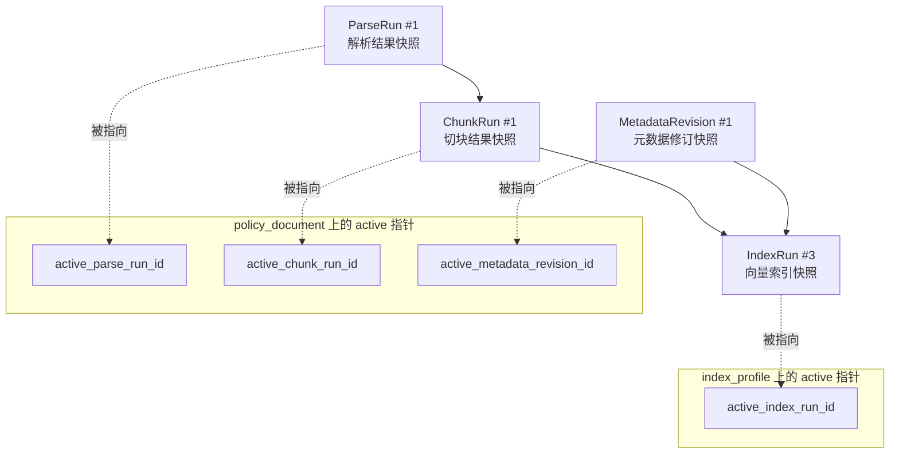
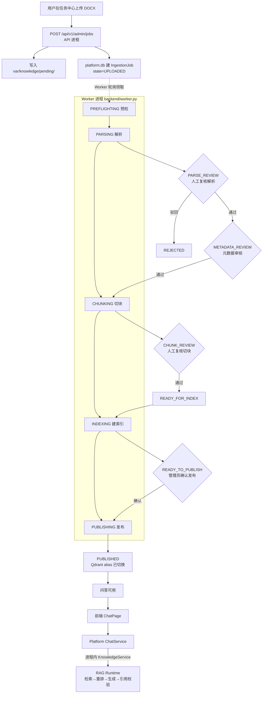
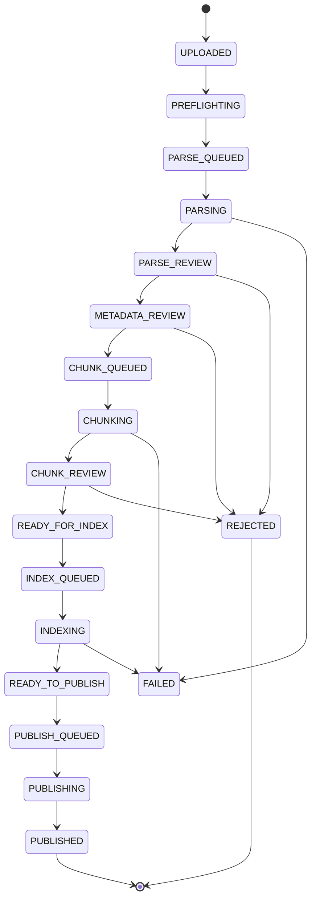
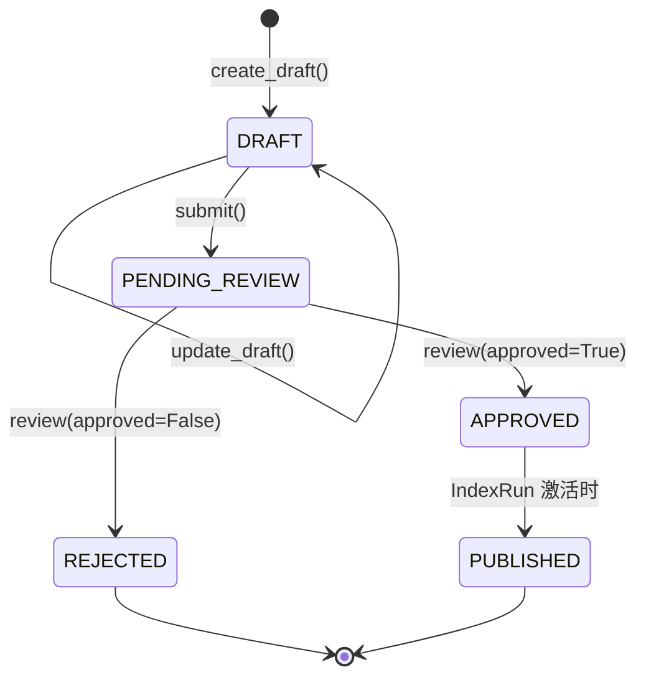
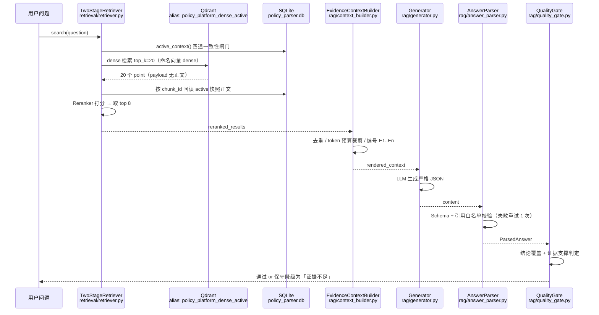
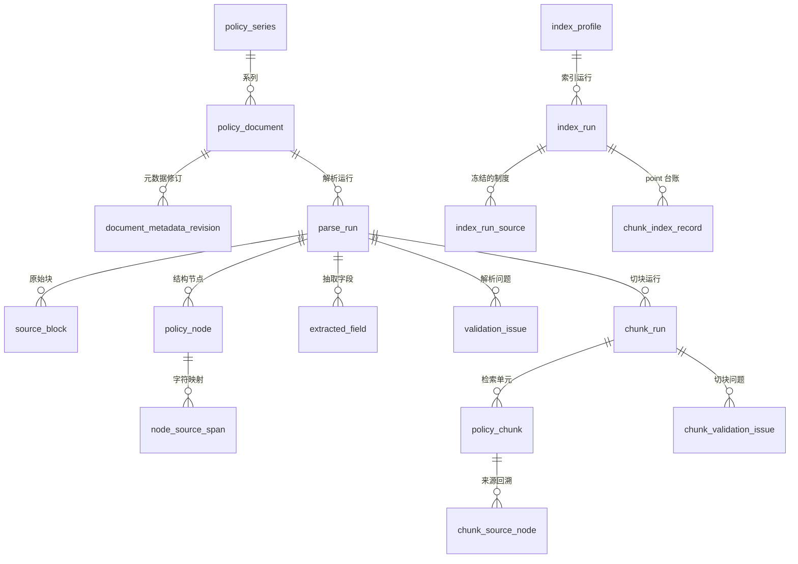

# 制度文档入库到问答全流程说明（新人上手导览）

> **文档定位**：面向第一次接触本项目的开发者，按数据流动顺序讲清「一份 DOCX 如何一步步变成可被问答引用的知识」。
>
> **生成日期**：2026-09-03
>
> **运行边界更新（2026-09-14）**：ADR-0004 已将 Web 问答恢复为 Platform 进程内
> `KnowledgeService → RagRuntime`。本文的入库、审核和发布说明仍然有效，问答章节已按当前实现更新。
>
> **行号说明**：文中的行号基于本文生成时的代码状态，仅用于快速定位。代码改动后行号会漂移，**函数名和文件路径是更稳定的锚点**，定位不到时请按函数名搜索。

---

## 0. 阅读前必须先知道的四件事

新人最容易在这四点上卡住，先说清楚再看流程。

### 0.1 有两个数据库，不是一个

| 数据库     | 物理位置                         | 归属                 | 存什么                                                                                           |
| ---------- | -------------------------------- | -------------------- | ------------------------------------------------------------------------------------------------ |
| **平台库** | `var/platform.db`                | `backend/app/`       | 用户会话、权限、**入库任务（IngestionJob）**、批次、审核请求、发布请求、聊天会话与消息、审计日志 |
| **知识库** | `var/knowledge/policy_parser.db` | `backend/knowledge/` | 制度文档本体、ParseRun、SourceBlock、PolicyNode、元数据修订、ChunkRun、PolicyChunk、IndexRun     |

这是一条重要的架构边界：**平台库管「流程与人」，知识库管「制度内容与版本」**。平台侧通过 `KnowledgeManagementService`（`backend/knowledge/management.py`）这一个门面跨过边界，不直接写知识库的表。

### 0.2 有两个进程，缺一个流程就不动

- **API 进程**：`uvicorn app.main:app --port 8020`，只负责接收请求、写任务记录、立刻返回。
- **Worker 进程**：`backend/worker.py`，真正执行解析、切块、索引这些重活。

**解析和索引绝不在 HTTP 请求线程里执行**（这是 `docs/PROJECT_HANDOFF.md:60` 明确的约束）。所以如果你上传了文档发现状态一直停在 `UPLOADED`，**第一反应应该是检查 Worker 有没有启动**，而不是查解析代码。

### 0.3 三层版本快照 + active 指针（全局最重要的概念）

系统里每一层加工结果都是**不可变的运行记录（Run）**，加上一个可切换的 active 指针。理解了这个，就理解了整个系统的设计骨架。



四个要点：

1. **Run 永不被覆盖**。重新解析产生新的 ParseRun，旧的原样保留。人工修正也是新建一个派生 Run（`parse_correction.py` 的 `run_kind='MANUAL_CORRECTION'`），不改历史。
2. **只有被 active 指针指向的 Run 才对外生效**。
3. **下一层只消费上一层的 active**。`PolicyChunker` 只处理 `active_parse_run_id` 的节点；`PolicyIndexer` 只冻结 `active_chunk_run_id` 的 chunk。
4. **IndexRun 是最终闸门**。一份制度即使解析、切块全部成功，只要没被纳入 active IndexRun 的 `index_run_source` 表，Platform 侧就**完全查不到它**（见 `backend/knowledge/read_service.py:233`、`:277`、`:314` 的 `JOIN index_run_source`）。

### 0.4 问答链路以 ADR-0004 为准

- Platform 的 `ChatService` 只通过进程内 `KnowledgeService` 调用 `RagRuntime`。
- 原 `D:\2-code\rag` 与 8010 已退出当前运行链路；应用层不得绕过 `KnowledgeService` 直接访问知识SQLite、Qdrant客户端或模型客户端。
- `backend/knowledge/rag/` 是Web问答与CLI共用的RAG实现，由 `KnowledgeService` 统一装配。
- ADR-0004 已取代 ADR-0003 的独立HTTP边界，并确认 ADR-0002 的进程内方向。

---

## 1. 全景流程图



**四个人工卡点**（流程不会自动越过）：解析复核 → 元数据审核 → 切块复核 → 发布确认。

---

## 2. 速查表：阶段 → 执行者 → 代码 → 数据落点

| #   | 阶段       | 任务状态          | 执行者               | 核心代码                                                   | 写入数据                                                                             | 落盘目录                 |
| --- | ---------- | ----------------- | -------------------- | ---------------------------------------------------------- | ------------------------------------------------------------------------------------ | ------------------------ |
| 1   | 上传       | `UPLOADED`        | API 进程             | `app/application/ingestion_service.py:create_job` (L37-95) | platform.db `IngestionJob`                                                           | `var/knowledge/pending/` |
| 2   | 预检       | `PREFLIGHTING`    | Worker               | `worker.py:run_once`                                       | platform.db 状态流转                                                                 | —                        |
| 3   | 解析       | `PARSING`         | Worker               | `knowledge/parser/pipeline.py:parse` (L85-312)             | 知识库 `parse_run`/`source_block`/`policy_node`/`extracted_field`/`validation_issue` | `accepted/`、`pdf/`      |
| 4   | 解析复核   | `PARSE_REVIEW`    | 人工                 | `knowledge/parser/review.py:decide`/`approve_run`          | 更新 `review_status`、置 `active_parse_run_id`                                       | —                        |
| 5   | 元数据审核 | `METADATA_REVIEW` | 人工                 | `knowledge/metadata_service.py`                            | `document_metadata_revision`                                                         | —                        |
| 6   | 切块       | `CHUNKING`        | Worker               | `knowledge/chunking/chunker.py:run_parse_run` (L119-231)   | `chunk_run`/`policy_chunk`/`chunk_source_node`/`chunk_validation_issue`              | —                        |
| 7   | 切块复核   | `CHUNK_REVIEW`    | 人工                 | `knowledge/chunking/review.py:approve_run`                 | 置 `active_chunk_run_id`                                                             | —                        |
| 8   | 建索引     | `INDEXING`        | Worker               | `knowledge/indexing/indexer.py:build` (L78-132)            | `index_run`/`index_run_source`/`chunk_index_record` + **Qdrant collection**          | —                        |
| 9   | 发布       | `PUBLISHING`      | Worker（需人工确认） | `indexing/database.py:activate_run` (L590-679)             | 切 `active_index_run_id` + **Qdrant alias** + 元数据置 PUBLISHED                     | —                        |
| 10  | 问答       | —                 | 用户                 | `app/application/chat_service.py:send_message` (L130-187)  | platform.db `ChatMessage`/`MessageCitation`                                          | —                        |

---

## 3. 任务状态机

状态机被冻结在 `backend/app/domain/ingestion.py`（全文仅 60 行，建议通读）。



关键设计（`domain/ingestion.py`）：

- `MAIN_FLOW`（L8-12）是唯一合法主干，16 个状态严格顺序推进。
- `TRANSITIONS`（L16-36）由 `MAIN_FLOW` 自动生成「只能走到下一个状态或 FAILED」，再补充可取消/可驳回的分支。**跨阶段跳跃会抛 `InvalidStateTransition`**（L51-53）。
- `TERMINAL_STATES`（L13）= `PUBLISHED`/`REJECTED`/`CANCELLED`，终态不可再流转。
- `RETRY_TARGETS`（L38-44）定义失败重试的回退落点：`PARSING` 失败退回 `PARSE_QUEUED`、`INDEXING` 失败退回 `INDEX_QUEUED`。**重试是回到队列重做，不是断点续跑**。
- 带 `-ING` 的进行中状态额外允许转向 `CANCEL_REQUESTED`（L31-35），用于协作式取消。

---

## 4. 阶段一：上传与落盘

### 前端

| 页面     | 文件                                          | 作用                                        |
| -------- | --------------------------------------------- | ------------------------------------------- |
| 任务中心 | `frontend/src/pages/admin/TaskCenterPage.tsx` | 新建单份/批量入库任务、任务列表、详情、重试 |

- `submitUpload()`（L55-76）判断单份还是批量，分别调 `uploadJob` 或 `createBatch` + `uploadBatchJob`。
- API 客户端 `frontend/src/api/admin.ts:uploadJob`（L103-118）：构造 `FormData`（`file`、`task_name`、`initial_document_status`），从 cookie 读 CSRF token，`POST /api/v1/admin/jobs`。
- **是普通 FormData 整文件上传，没有分片逻辑**。大文件要注意超时。

### 后端

```
TaskCenterPage.tsx:submitUpload
  → api/admin.ts:uploadJob            FormData
  → POST /api/v1/admin/jobs
  → app/api/v1/admin.py:create_job    (L101-111)
  → require_permission("knowledge.ingestion.manage", csrf=True)
  → app/application/ingestion_service.py:create_job  (L37-95)
```

`IngestionService.create_job` 做四件事：

1. 校验文件（扩展名、大小）并计算 SHA-256，用于查重。
2. `paths.pending_documents.mkdir(parents=True, exist_ok=True)`（L63）。
3. 落盘：`target.write_bytes(content)`（L84-87），文件名为 `{job.id}_{安全化后的原名}`，`_safe_filename` 在 L240-241 清理不安全字符。
4. 在 platform.db 建 `IngestionJob`，初始状态 `UPLOADED`。

**路径配置链**（改目录时要一起看这三处）：

```
PLATFORM_KNOWLEDGE_DATA_ROOT (环境变量)
  → app/config.py:Settings.knowledge_data_root  默认 <项目根>/var/knowledge
  → knowledge/config.py:KnowledgePaths          派生各子目录
```

`KnowledgePaths`（`knowledge/config.py:12-46`）用 `@property` 派生全部子目录，`__post_init__` 里做了 `resolve()`。设计意图写在文件头注释：**数据库只存相对路径，避免依赖启动时的工作目录**。

### 目录职责

| 目录                | 何时写入                        | 由谁写                                     |
| ------------------- | ------------------------------- | ------------------------------------------ |
| `pending/`          | 上传时                          | `ingestion_service.py:create_job` (L84-87) |
| `source_documents/` | CLI 导入原始件时                | `cli.py:import_document` (L108-120)        |
| `accepted/`         | 解析的 revision_acceptance 阶段 | `pipeline.py:126` `create_accepted_final`  |
| `pdf/`              | 解析的 pdf_render 阶段          | `pipeline.py:199-214` `render_docx_to_pdf` |
| `temp/`             | 临时中间文件                    | —                                          |

---

## 5. 阶段二~三：预检与解析（最重的一步）

### Worker 如何领活

`backend/worker.py:run_once`（L35-88）从 `IngestionJob` 表领取任务，用 **lease 机制**防止并发重复执行，串行处理。它只关心三种待办状态：`UPLOADED`、`PARSE_QUEUED`、`CHUNK_QUEUED`。

```
UPLOADED       → transition(PREFLIGHTING) → transition(PARSE_QUEUED)
PARSE_QUEUED   → management.parse_pending_document(source) → 校验返回status → PARSE_REVIEW或FAILED
CHUNK_QUEUED   → management.build_chunk_run(document_id)   → 校验返回status → CHUNK_REVIEW或FAILED
```

知识流水线可能通过“返回已落库的 `status='failed'` 摘要”报告失败，Worker 必须检查返回状态，
不能只依赖Python异常。失败Run也在审核服务入口被再次阻断，不能通过刷新审核状态变成成功。

`run_publication`（L91-158）是另一条独立循环，处理 `IndexPublicationRequest`（见第 8、9 阶段）。

### 解析流水线的八个阶段

入口 `PolicyParserPipeline.parse(source_path)`（`knowledge/parser/pipeline.py:85-312`）。每步都调 `_stage()`（L81-83）更新 `parse_run.current_stage` 并输出进度，**排障时先看这个字段停在哪**。

| 顺序 | current_stage          | 做什么                                                         | 关键函数                                       |
| ---- | ---------------------- | -------------------------------------------------------------- | ---------------------------------------------- |
| 1    | `file_validation`      | DOCX ZIP 结构、关键 XML、大小、压缩比、外部关系校验            | `ooxml.py:validate_docx`                       |
| 2    | `revision_acceptance`  | 检测 Word 修订痕迹，生成「接受全部修订」的 accepted_final 副本 | `ooxml.py:create_accepted_final` (调用于 L126) |
| 3    | `source_extraction`    | 按 OOXML 原始顺序提取段落/表格/编号/页眉页脚                   | `ooxml.py:extract_source_blocks` (L632+)       |
| 4    | `structure_analysis`   | 构建 Node Tree（章/节/条/项/段落）                             | `analyzer.py:build_nodes` (L415-487)           |
| 5    | `metadata_extraction`  | 提取标题、文号、日期、文种、收文对象候选                       | `analyzer.py:extract_metadata` (L112+)         |
| 6    | `structure_validation` | 编号连续性、来源覆盖率、异常节点校验                           | `analyzer.py:validate_structure` (L489-606)    |
| 7    | `pdf_render`           | LibreOffice/Word 无头渲染 PDF（可关）                          | `render.py:render_docx_to_pdf`                 |
| 8    | `page_mapping`         | 把 SourceBlock 对齐到 PDF 页码                                 | `render.py:map_blocks_to_pdf_pages`            |

完成时 `current_stage='completed'`，异常时 `'exception'`。

### 安全设计：三道防线

`ParserConfig`（`pipeline.py:31-50`）里的这几项是防 ZIP 炸弹的：

```
max_zip_entries: 5000
max_uncompressed_bytes: 500MB
max_compression_ratio: 200.0
```

另外注释明确写了 **不使用大模型改写任何制度文字**（`analyzer.py` 文件头）——解析全程是确定性规则，模糊结果保留候选值和置信度交人工，这是可审计性的基础。

### 结构分析的核心：Node 类型判定

`analyzer.py:_classify`（L341-412）按**优先级短路**判定节点类型，顺序即优先级：

1. 表格 → `table`（L346-347）
2. 完整/不完整文号 → `document_code`（L349-352）
3. 正则匹配 `chapter`/`section`/`article`/`attachment`（L354-359，置信度 0.99）
4. 分发类型「送/分送/抄送/印发」→ `distribution`（L361-364）
5. 落款机关与日期上下文 → `signature`（L366-378）
6. 收文对象（前 12 段内、以冒号结尾、含单位类词）→ `addressee`（L380-381）
7. 全文最后 8 段内含完整日期 → `signature`（L383-384）
8. `一、` 形式 → `heading` 或 `item`（L386-396，**在 article 上下文内或超 30 字或以句号/分号结尾时判为 item**）
9. `（一）`/`1.`/`(1)`/`①` → `item`（L398-400）
10. Word 原生编号 + outline_level → `heading`/`item`（L402-407）
11. 前 20 段且无父节点且以「为/根据/按照」开头 → `preamble`（L409-410）
12. 兜底 → `paragraph`（L412）

`build_nodes`（L415-487）用**层级栈 + rank** 组装父子关系：`rank` 小的层级更高，遇到 rank 不小于栈顶的节点就出栈（L428-429），从而自动建立 章 > 节 > 条 > 项 的树。

> **已知待改进点**：article 的标题抽取（L441-451）当前用「剩余文字 ≤ 24 字」作为四个与条件之一（阀值已从初版 18 调为 24），长度一票否决会漏掉较长的「……奖励标准：」这类标题。完整分析与改进方案见**附录 B**。

### 覆盖率阈值与状态判定（排障重点）

这是解析结果为什么「失败」或「要复核」的判定逻辑，两个文件配合：

**第一步**，`analyzer.py:validate_structure` 按字符覆盖率产出 issue（L592-597）：

| 条件                        | issue_code                  | severity |
| --------------------------- | --------------------------- | -------- |
| `character_coverage < 0.95` | `LOW_CHARACTER_COVERAGE`    | `error`  |
| `0.95 ≤ coverage < 0.98`    | `REVIEW_CHARACTER_COVERAGE` | `review` |

覆盖率本身在 L538 计算（`mapped_chars / 总字符数`）。

> ⚠️ **一个容易踩的坑**：`ParserConfig` 里确实定义了 `character_error_threshold = 0.95` 和 `character_review_threshold = 0.98`（`pipeline.py:44-45`），**但这两个字段全仓只有定义、没有任何读取**。实际生效的阀值是 **硬编码在 `analyzer.py:592` 和 `:595`** 的字面量 `0.95` / `0.98`。想调阀值只改 `ParserConfig` 会**完全无效**，必须改 `analyzer.py`（或把 `validate_structure` 改成接参数）。

其他 issue：`EMPTY_NODE`、`ABNORMAL_SHORT_NODE`（只有标点的段落）、`OVERSIZED_NODE`（>5000 字符）、`LOW_STRUCTURE_CONFIDENCE`（置信度 <0.85）、`ARTICLE_SEQUENCE_GAP`（条号不连续）、`UNMAPPED_BLOCK`（有效块未映射到节点）。

**第二步**，`pipeline.py:254-256` 汇总决定 ParseRun 状态：

```
存在 severity='error' 的 issue          → status='failed'
存在 severity='review' 或待审字段/节点  → status='review_required', review_status='pending'
否则                                    → status='succeeded'
```

`parse_run.status` 取值：`running` / `succeeded` / `review_required` / `failed`
`parse_run.review_status` 取值：`pending` / `not_required` / `required` / `approved`

**异常兜底**（L284-312）：捕获所有异常，写 `status='failed'`、`error_code='PIPELINE_EXCEPTION'`、`error_message`，并插一条 validation_issue。失败文件仍保留在受控 `pending/`，由任务与Run的失败状态统一管理，不再维护 `quarantine/` 双重状态。

---

## 6. 阶段四：解析复核（第一个人工卡点）

### 前端

| 页面       | 路由             | 文件                                               |
| ---------- | ---------------- | -------------------------------------------------- |
| 审核工作台 | `/admin/reviews` | `frontend/src/pages/admin/ReviewWorkbenchPage.tsx` |

管理台路由集中在 `frontend/src/routes/router.tsx:36-48`，全部包在 `<RequireAdmin />` 里。

### 后端：ReviewService

文件 `backend/knowledge/parser/review.py`（237 行，建议通读），三个核心方法：

**`decide()`（L66-134）** —— 审核单个对象。

- 支持三种 `target_type`（L16-20）：`issue` → `validation_issue` 表、`field` → `extracted_field` 表、`node` → `policy_node` 表。
- 四种 `action`（L21）：`confirm` / `reject` / `ignore` / `correct`。
- `correct` **只支持字段**，且必须带 `corrected_value`（L96-98），改写 `extracted_field.normalized_value` 并置 `review_status='confirmed'`。
- 每次操作都往 `review_decision` 表插一行，**存 before/after 的完整 JSON 快照**（L115-133）。这是审计闭环的关键：任何人工改动都可回溯。
- 最后必定调用 `refresh_state()`。

**`refresh_state()`（L160-173）** —— 重算 ParseRun 状态，**但绝不自动批准**。

判定用的五个计数在 `_pending_counts()`（L136-158）：

```
issues             未 resolved 且 severity 属于 error/review 的 issue 数
nodes              review_status='pending' 的节点数
fields             review_status='pending' 的字段数
rejected_nodes     review_status='rejected' 的节点数
rejected_decisions 最近一次决策为 reject 的对象数（用窗口查询取每个对象的 MAX(id)）
```

然后：

```
rejected = rejected_fields + rejected_nodes + rejected_decisions > 0
pending  = issues + nodes > 0          ← 注意：不含 fields
review_status = rejected  ? 'rejected'
              : pending   ? 'pending'
              : 'ready_for_approval'
```

> **值得注意的设计**（L168 注释）：`pending` 的计算**故意不算 `fields`**，因为元数据字段交由独立的元数据修订页统一确认，ParseRun 只冻结「结构、页码、解析问题」这三件事。所以「解析复核通过」不等于「元数据已确认」，两者是分开的卡点。

**`approve_run()`（L175-236）** —— 批准并设为 active。

1. 先 `refresh_state()`，`review_status` 必须是 `ready_for_approval`，否则抛错（L179-180）。
2. 收集所有 `review_status='confirmed'` 的字段，按 `confidence DESC` 排序，取每个字段名的**第一个**值（L182-195），只保留 `DOCUMENT_FIELD_NAMES`（L22-36）里的 13 个字段。
3. 置 `parse_run.status='succeeded'`、`review_status='approved'`，记录 `reviewed_by`/`reviewed_at`。
4. 更新 `policy_document`：`active_parse_run_id = run_id`、`parser_status='succeeded'`、`review_status='passed'`（L203-213）。
5. 往 `review_decision` 插一条 `target_type='run', action='approve'` 的记录。

> **关键注释**（L202）：「ParseRun 批准只推进候选解析指针；公开元数据由 IndexRun 冻结的修订决定」。也就是说 `approve_run` 收集的 `document_fields` **只写进审计快照，不直接写 policy_document 的元数据列**。这是理解「为什么解析出了标题，但列表页还显示旧标题」的关键。

### 人工修正走的是派生 Run，不是原地改

`backend/knowledge/parse_correction.py` 提供人工修正能力，产出的是 `run_kind='MANUAL_CORRECTION'` 的**新 ParseRun**，通过 `ALLOWED_NODE_FIELDS` 白名单限定可改字段。原 ParseRun 一字不动。

---

## 7. 阶段五：元数据治理（第二个人工卡点）

### 前端

| 页面     | 路由               | 文件                                                                              |
| -------- | ------------------ | --------------------------------------------------------------------------------- |
| 知识治理 | `/admin/knowledge` | `frontend/src/pages/admin/KnowledgeGovernancePage.tsx`（懒加载，`router.tsx:29`） |

### 为什么需要独立的元数据修订层

解析器能从正文里**猜**出标题、文号、日期，但：

- 猜错的代价很高（制度名称错了，引用就错了）；
- 有些字段正文里根本没有（责任部门、密级、失效日期）；
- 制度的生效/废止状态**不能靠猜**。

所以设计了 `document_metadata_revision` 表：每次改元数据都是一个带生命周期的修订版本。

### 生命周期



代码在 `backend/knowledge/metadata_service.py`：

| 方法           | 行号     | 关键规则                                                                                                                   |
| -------------- | -------- | -------------------------------------------------------------------------------------------------------------------------- |
| `create_draft` | L200-242 | 首份 INITIAL 草稿采用上传时的 `initial_document_status` 声明（L207-211），后续修订**始终继承已审核元数据**，不再看上传声明 |
| `update_draft` | L244-262 | 只有 `DRAFT` 可改；字段白名单 `REVISION_EDIT_FIELDS`（L22）                                                                |
| `submit`       | L264-279 | 四个必填：制度名称、发布机构、责任部门、发布日期（L268-275）                                                               |
| `review`       | L281-314 | 通过则写 `policy_document.approved_metadata_revision_id`（L306-313）；驳回**必须填原因**（L294-295）                       |

**`submit()` 里最容易被问到的一条规则**（L276-278）：

```python
status = str(revision.get("status") or "unknown").strip().lower()
if status == "unknown" and not str(revision.get("status_confirmation_note") or "").strip():
    raise MetadataConflictError("制度状态为待确认时必须填写保留原因")
```

这解释了为什么库里会有一堆 `status='unknown'` 的制度：**解析器不猜制度是否生效**，默认就是 `unknown`；要变成 `effective` 只有两条路——上传时显式声明，或人工在修订里确认。系统允许你保留 `unknown`，但**必须写下为什么保留**，不让「不知道」悄悄溜过去。

### 三个元数据指针的区别

`policy_document` 上有三个元数据指针，含义完全不同，别混：

| 字段                            | 含义                   | 谁写                                |
| ------------------------------- | ---------------------- | ----------------------------------- |
| `latest_metadata_revision_id`   | 最新草稿（可能还没审） | `create_draft` (L238-241)           |
| `approved_metadata_revision_id` | 已审核通过、等待发布   | `review` (L306-313)                 |
| `active_metadata_revision_id`   | **当前对外生效**       | `indexing/database.py:activate_run` |

**对外展示读的是 `active_`**（见 `metadata_service.py` 文件头注释：「公开读取始终使用 active IndexRun 冻结的 metadata_revision_id」）。所以元数据审核通过后前台还没变，是正常的——要等索引发布。

---

## 8. 阶段六：切块（Chunking）

### 入口与总体流程

文件 `backend/knowledge/chunking/chunker.py`（1455 行）。入口三层：

```
run_all_active()           L103-107  遍历所有有 active_parse_run_id 的文档
  → run_document(doc_id)   L109-117  查 active_parse_run_id
    → run_parse_run(id)    L119-231  真正干活
```

`run_parse_run` 的执行顺序（L183-219）：

```
_load_nodes(parse_run_id)                     加载节点树
_detect_inline_contexts(nodes)                识别内联上下文节点
_eligible_nodes(nodes, ...)                   筛出合格节点
_generate_drafts(...)                         生成 chunk 草稿
_insert_drafts(chunk_run_id, drafts)          写 policy_chunk + chunk_source_node
_validate_run(...)                            质量校验，产出 issue 与 metrics
_insert_issues(...)                           写 chunk_validation_issue
_issue_counts(chunk_run_id)                   汇总
→ 有 error 或 review    → status='review_required', review_status='pending'
→ 无                    → status='succeeded',       review_status='not_required'
→ 若 activate 且未被阻塞 且 source_scope=='active' → activate_run_if_ready()
```

### 三条重要的前置约束

**1. 正式模式只能吃 active ParseRun**（L128-135）

```python
is_active = active_parse_run_id is not None and int(active_parse_run_id) == parse_run_id
if not is_active and not allow_unreviewed:
    raise ValueError(...)
source_scope = "active" if is_active else "experimental"
```

`source_scope='experimental'` 的 ChunkRun **永远不能被批准为正式版本**（`review.py:222-223`）。这保证了实验性切块不会污染检索。

**2. 幂等复用**（L139-150）

用 `(parse_run_id, chunker_version, config_hash)` 三元组查重。参数没变就直接复用已有 ChunkRun，不重复计算。`config_hash` 是 `ChunkerConfig` 全字段的 canonical JSON 的 SHA-256（L78-83），**改任何一个参数都会产生新的 ChunkRun**。

**3. 节点类型三分法**（L23-25）

```python
RETRIEVAL_TYPES = {"article", "item", "paragraph", "preamble", "table"}   # 生成 chunk
CONTEXT_TYPES   = {"chapter", "section", "heading", "attachment"}         # 只做上下文前缀
EXCLUDED_TYPES  = {"addressee", "signature", "distribution", "document_code"}  # 完全排除
```

收文对象、落款、分发范围、文号**不进检索**——它们不是制度内容。

### 切块参数

`ChunkerConfig`（L51-83）：

| 参数                  | 默认值               | 作用                           |
| --------------------- | -------------------- | ------------------------------ |
| `strategy`            | `structure_first_v1` | 结构优先，不是按固定长度硬切   |
| `target_chars`        | 450                  | 目标长度                       |
| `soft_max_chars`      | 600                  | 软上限，超过则尝试在句边界切分 |
| `hard_max_chars`      | 1200                 | 硬上限                         |
| `overlap_chars`       | 60                   | 切分时的重叠字符数             |
| `min_retrieval_chars` | 20                   | 低于此长度的检索文本会报 issue |
| `table_repeat_header` | True                 | 表格切分时重复表头             |

句边界用 `SENTENCE_END`（L26）识别：`[。！？!?；;]` 或换行。

### retrieval_text 的组装（决定召回质量）

每个 chunk 有多个文本字段，**送去 embedding 的是 `retrieval_text`**：

```
node.title / node_number  →  _node_label()      L891-898
                          →  path_text          章节路径，如「第二章 奖励 / 第三条 奖励标准」
                          →  prefix_text        上下文前缀
                          →  retrieval_text     最终送 embedding 的文本
```

`_node_label()`（L891-898）有个重要行为：

```python
number = str(node.get("node_number") or "").strip()
title = str(node.get("title") or "").strip()
if number or title:
    return " ".join(part for part in (number, title) if part)
```

**只要 `node_number` 存在，就不会回落到 content**。所以如果某个条的 `title` 没被解析出来，它的 `path_text` 就只剩「第三条」这样一个光秃秃的编号，主题词全部丢失——这直接损害该条及其全部子项的向量召回。这就是第 5 章提到的标题解析问题为什么重要（详见附录 B）。

### 一个必须记住的坑：`_eligible_nodes` 会踢掉未确认节点

L292 有一行：

```python
if node["review_status"] != "confirmed": continue
```

**节点的 `review_status` 不是 `confirmed` 就完全不参与切块**，也就完全不可检索。所以在解析复核时，对于「不确定是标题还是正文」这类灰区，**绝不能图省事标成 `pending`**——那等于把整条制度从知识库里删掉，代价远大于标题判错。灰区应该只发 issue 提示，不动 `review_status`。

### 质量校验产出的 issue

`_validate_run` 会产出十几种 `issue_code`，按 `severity` 分三档：

- `error`：**必须驳回重跑**，不能确认或忽略（`review.py:72-77` 强制）。
- `review`：可确认或忽略，但未处理完不能批准。
- `warning`：不阻塞。

典型 issue：`UNMAPPED_ELIGIBLE_NODE`（合格节点没生成 chunk）、`SHORT_RETRIEVAL_TEXT`、`OVERSIZED_CHUNK`、`EMPTY_RETRIEVAL_TEXT`、`COVERAGE_GAP`。

`chunk_run.unmapped_node_count > 0` 是**硬阻断**：`activate_run_if_ready`（L1418）和 `approve_run`（`review.py:228-229`）都会拒绝。设计意图很明确——**宁可不发布，也不允许制度内容悄悄漏掉**。

---

## 9. 阶段七：切块复核（第三个人工卡点）

文件 `backend/knowledge/chunking/review.py`（269 行）。与解析复核结构相似，但有几处不同：

| 差异点        | 解析复核               | 切块复核                                  |
| ------------- | ---------------------- | ----------------------------------------- |
| `target_type` | `issue`/`field`/`node` | `chunk_issue`/`chunk`（L45-50）           |
| `action`      | 4 种（含 `correct`）   | 3 种，**没有 `correct`**（L16）           |
| error 级问题  | 可确认                 | **禁止确认或忽略，只能 reject**（L72-77） |
| 额外方法      | —                      | `reject_run()`（L118-153）                |

**为什么切块不给 `correct`**：chunk 是从节点确定性推导出来的产物，手改 chunk 会让它和来源节点不一致，破坏溯源。要改就回去改解析结果或调切块参数重跑。这是「产物不可手改，只改输入」的一致原则。

### `approve_run()` 的五道校验（L209-229）

```
1. review_status 必须是 ready_for_approval
2. source_scope 必须是 'active'          → 实验 ChunkRun 不得批准
3. 文档必须有 active_parse_run_id
4. active_parse_run_id == chunk_run.parse_run_id   → 期间解析版本变了就拒绝
5. unmapped_node_count == 0
```

第 4 条是**乐观锁**：如果你在审切块的时候有人重新解析并批准了新 ParseRun，这个 ChunkRun 就基于过期数据了，必须重新生成。

通过后写 `policy_document.active_chunk_run_id = chunk_run_id`（L244-246）。

### 自动激活：`activate_run_if_ready()`

在 `chunker.py:1388-1433`，切块跑完若没被阻塞会自动尝试激活。七个条件全部满足才切指针（L1411-1419）：

```
source_scope == 'active'
status == 'succeeded'
review_status in {'not_required', 'approved'}
active_parse_run_id 非空
active_parse_run_id == parse_run_id
未解决的 error/review issue 数 == 0
unmapped_node_count == 0
```

事务内**二次确认** `active_parse_run_id` 没变（L1423-1428），防竞态。

> 所以「零问题的干净文档」会自动从切块直通 `active_chunk_run_id`，不需要人点确认；**只有存在 review 级问题时才真正需要人工介入**。这是三个人工卡点里唯一可能被自动跳过的。

---

## 10. 阶段八：索引构建（唯一接触向量库的阶段）

### 前置：谁触发索引

索引**不是**由单个任务触发的，而是由**发布请求**触发的批量操作：

```
管理员选定 1~20 个制度
  → publication_service.py:create (L21)      建 IndexPublicationRequest，status=BUILD_QUEUED
  → worker.py:run_once (L42-46)              优先处理发布请求，优先级高于普通入库任务
  → worker.py:run_publication (L100-117)     status=BUILDING，相关 job 转 INDEXING
  → management.build_index_run(required_document_ids=[...])
  → indexer.py:build (L78-132)
```

注意 `run_once` L42-46：**发布请求优先级高于普通入库任务**。Worker 每轮先看有没有 `BUILD_QUEUED`/`PUBLISH_QUEUED` 的发布请求，有就先干这个。

`publication_service.py:create`（L21-24）限制**一次发布 1~20 个制度**。

### `PolicyIndexer.build()` 的十步（L78-132）

```
1.  get_or_create_profile(profile_name, alias_name)      拿到 index_profile
2.  _reconcile_switching_run(profile_id)                 修复上次崩在 switching 中间的 run
3.  freeze_active_sources(required_document_ids)          冻结所有 active ChunkRun 快照
4.  source_manifest_hash(sources)                        算来源清单哈希
5.  collection_name(manifest_hash, contract_hash)        推导物理 collection 名
6.  find_run(profile_id, manifest_hash, contract_hash, config_hash)   四元组幂等查重
7.  create_run(...)  （若第 6 步没查到）                   建 index_run
8.  ensure_chunk_records(...)                            为每个 chunk 建 chunk_index_record + point_id
9.  _execute_run(run_id)  （若 status != succeeded）      embedding + upsert + 全量核验
10. _activate(profile_id, run_id)  （若 activate=True）   切 alias + 切 SQLite 指针
```

第 6 步的四元组（来源清单 + 向量契约 + 索引配置 + profile）完全一致就复用旧 run，一个字节都不重算。

### 命名规则：collection 与 alias

`indexing/config.py:218-223`：

```python
def collection_name(self, source_manifest_hash: str, contract_hash: str) -> str:
    return f"{self.collection_prefix}_{source_manifest_hash[:12]}_{contract_hash[:8]}"
```

实际形如：`policy_platform_dense_a3f2b1c4d5e6_7f8a9b0c`

| 概念          | 值                                                               | 特性                                |
| ------------- | ---------------------------------------------------------------- | ----------------------------------- |
| collection 名 | `policy_platform_dense_{manifest12}_{contract8}`                 | **每个版本一个新的物理 collection** |
| alias 名      | `policy_platform_dense_active`（`IndexConfig.alias_name`，L188） | **固定不变**，检索只认它            |

这是标准的蓝绿部署：新索引在**新 collection** 里默默建好并全量核验，只有最后一刻把 alias 指过去。**建索引期间线上检索完全不受影响**；失败了 alias 还指着旧的，等于什么都没发生。

### Embedding 契约：为什么要哈希

`EmbeddingContract`（`config.py:28-76`）的 13 个字段全部参与 `contract_hash`：

```
provider / model / model_revision / dimension / normalize_embeddings
distance_metric / vector_name / document_input / query_instruction
instruction_language / max_input_tokens / truncation / contract_version
```

默认：`qwen3-embedding-4b`，**2560 维**，cosine，命名向量 `dense`。

三条硬约束写在 `__post_init__`（L47-55）：

```
distance_metric 只允许 cosine
vector_name 不能为空
truncation 只允许 "reject"    ← 禁止静默截断
```

`truncation='reject'` 这条很重要：超长输入**直接报错而不是悄悄砍掉**。制度文本被截断意味着检索时丢内容，而这种错误静默发生时几乎不可能被发现。

`contract_hash` 的作用是防「**模型名相同但向量空间不同**」——同一个 `qwen3-embedding-4b`，改了 `query_instruction` 或换了部署版本，向量就不可比。检索时会校验查询侧的 contract_hash 与 active IndexRun 是否一致（`retriever.py:89-90`），不一致直接拒绝检索。

查询侧还会加固定 instruction（`format_query`，L68-74）：

```
Instruct: Given a policy and regulation query, retrieve passages that directly answer it.
Query:{用户问题}
```

**文档侧不加 instruction，只有查询侧加**——这是 Qwen3-Embedding 的官方用法。

### point_id：确定性 UUID

`indexer.py:122-125`：

```python
lambda chunk_id: uuid5(NAMESPACE_URL, f"policy-index:{profile_name}:{run_id}:{chunk_id}")
```

用 `uuid5`（确定性哈希）而非 `uuid4`（随机），保证**同样输入永远得到同样 point_id**，重跑幂等。key 里带了 `run_id`，所以不同 IndexRun 的同一个 chunk 有不同 point_id——因为它们在不同 collection 里，互不干扰。

### 分批 embedding 与写入

`_process_batch`（L178-214），`batch_size=16`：

```
mark_embedding(record_ids)                          标记为 embedding 中
embedding_client.embed([retrieval_text, ...])       批量取向量
校验：返回数量 == batch 大小；每个向量维度 == 2560
_payload(run_id, record)                            组装 payload
vector_store.upsert(collection, "dense", points)    写 Qdrant
mark_indexed(dimension, vector_norm, payload_hash)  回写本地记录
```

**失败处理**（L212-214）：`mark_failed(record_ids, "embedding_or_upsert", ...)` 后 `raise`，整个 run 置 `failed`。**不做部分成功**。

### Qdrant payload 的 18 个字段

`_payload`（L216-240）。必填 10 个：

```
point_schema_version   固定 "policy_point_v1"
index_run_id           属于哪个 IndexRun
chunk_id / chunk_key   chunk 标识
document_id            所属制度
parse_run_id           来源解析版本
chunk_run_id           来源切块版本
chunk_type             article / item / paragraph / preamble / table
document_status        effective / unknown / repealed / expired
embedding_input_hash   embedding 输入文本的哈希（防漂移）
```

可选 8 个（值非 None 才写入，L239）：

```
parent_chunk_id / document_title / document_code / confidentiality_level
authority_level / path_text / page_start / page_end
```

> **注意：payload 里不存正文文本**。检索命中后必须用 `chunk_id` 回 SQLite `hydrate_chunks` 取正文（`retriever.py:122`）。Qdrant 只负责回答「哪些 chunk 相关」，**SQLite 才是内容的唯一真相源**。这个分工让内容修正不必重建向量库。
>
> `document_status`、`confidentiality_level`、`authority_level` 进 payload 是为了**在向量检索阶段就能过滤**（`build_filter`，`retriever.py:104-109`），不用先召回再筛。

### 全量核验 `_verify_run`（L242-274）

发布前的核验非常严格，**逐个 point 比对**：

```
1. 本地记录数 == expected_count                        否则 RuntimeError
2. Qdrant exact_count() == expected_count              否则 RuntimeError
3. 分批（每 64 个）retrieve 回来，逐个 _verify_point：
   - point 存在
   - 向量维度 == 2560
   - payload 的 index_run_id / chunk_id /
     embedding_input_hash / point_schema_version 四个字段一致
   - canonical_json(payload) 的 SHA-256 == 本地 payload_hash
4. 最终 indexed_count == verified_count == expected 且 failed_count == 0
```

`exact_count` 用的是精确计数不是估算值。第 3 步的 `payload_hash` 比对意味着 **payload 里任何一个字符不一致都会被发现**。

还有一道时效性检查（L157-158）：

```python
if self.config.strict_source_freshness and not self.db.sources_are_current(run_id):
    raise RuntimeError("构建期间 active ChunkRun 已变化，拒绝发布过期索引")
```

建索引期间如果有人批准了新的 ChunkRun，这个索引就过期了，**拒绝发布**。

---

## 11. 阶段九：发布（第四个人工卡点，Alias 切换是唯一发布时点）

### 触发链

```
管理员在治理页确认发布
  → publication_service.py:queue_publish (L68-71)   校验 status==READY_TO_PUBLISH 且有 index_run_id
                                                     → status=PUBLISH_QUEUED
  → worker.py:run_publication (L119-145)
    → job 转 PUBLISH_QUEUED → PUBLISHING
    → management.publish_index_run(index_run_id)
      → indexer.py:_activate (L301-316)
    → publication.status=PUBLISHED，job 转 PUBLISHED
```

### `_activate()` 的顺序（L301-316）

```
1. run.status 必须是 'succeeded'                          否则 ValueError
2. strict_source_freshness 检查 sources_are_current       否则 ValueError
3. update_run(activation_status='switching')              先落「正在切」的标记
4. vector_store.switch_alias(alias, collection)           ← Qdrant 侧原子切换
5. alias_target(alias) 读回来核对                          不一致则 RuntimeError
6. db.activate_run(profile_id, run_id)                    ← SQLite 侧切指针
```

**顺序不能颠倒**。第 3 步先写 `switching` 是为了留下崩溃痕迹：如果进程在第 4、5 步之间挂掉，下次 `build()` 开头的 `_reconcile_switching_run`（L325-339）会读 Qdrant 实际 alias 指向来对账：

```
alias 已指向该 collection 且 status=succeeded  →  补做 db.activate_run
alias 未指向该 collection                      →  activation_status 回退 inactive
```

**以 Qdrant 的实际状态为准**修复 SQLite。这是标准的最终一致性对账。

### `db.activate_run()` 做的三件事（`indexing/database.py:590-679`）

这是「active IndexRun」这个概念真正落地的地方：

**1. 切唯一指针**：`index_profile.active_index_run_id = run_id`，新 run 置 `activation_status='active'`。

**2. 旧 run 让位**：同 profile 下其他 run 置 `activation_status='superseded'`。**同一时刻全局只有一个 active IndexRun。**

**3. 元数据正式发布**（L645-679）：把本次纳入的每份文档的 `approved_metadata_revision_id` 对应修订置 `lifecycle_status='PUBLISHED'`，**回写 14 个元数据字段到 `policy_document`**，同时置 `active_metadata_revision_id`。

第 3 点解释了第 7 章那个悬念：**元数据审核通过后前台不变，要等这一刻**。「审核通过」只是候选，「索引发布」才是生效。

### active IndexRun 到底是什么

它是**检索版本指针**，三个作用：

1. **一致性闸门**。检索前 `retriever.py:86-97` 四道校验，任一不过拒绝检索：
   ```
   context['status'] == 'succeeded'
   context['activation_status'] == 'active'
   查询侧 contract_hash == active IndexRun 的 embedding_contract_hash
   Qdrant alias 实际指向 == active IndexRun 的 collection_name
   ```
   无 active run 时 `active_context()`（`database.py:681-694`）直接抛 `ValueError`。
2. **决定哪些制度可见**。`read_service.py:233`、`:277`、`:314` 三处都 `JOIN index_run_source`。**没进 active IndexRun 的制度，Platform 侧完全查不到**——不是「查到但空」，是「不存在」。
3. **元数据发布的触发点**（上面第 3 件事）。

> **常见困惑**：「active IndexRun 是 3，共 11 份制度，1 份 effective，10 份 unknown」——这是**两个正交维度**。`active_index_run_id=3` 说的是「当前检索用第 3 号索引快照，它冻结了这 11 份制度」；`effective`/`unknown` 说的是每份制度自己的**生命周期状态**（是否仍然有效）。10 份 unknown 只是意味着还没人在元数据里确认它们的生效状态，它们**照样可被检索**。两者互不影响。

### 失败处理

`worker.py:run_publication` 的 except（L146-158）：`publication.status='FAILED'`，相关 job 转 `FAILED` 并置 `retryable=True`。`publication_service.py:retry`（L78-81）允许重试失败的发布请求。

**关键**：失败时 alias 没切，旧 active IndexRun 完好无损，线上检索毫无影响。

---

## 12. 阶段十：问答（RAG）

> **入库的终点在这里被消费。** 前面九个阶段的全部努力，最终只为了让这一步能拿到「可溯源、不会漂移」的证据。

### 12.1 Web 侧调用链

```
ChatPage.tsx（frontend/src/pages/ChatPage.tsx）
  └─ POST /api/v1/chat/sessions/{session_id}/messages   （chat.py:72-86 send_message）
       └─ ChatService.send_message（chat_service.py:130-187）
             └─ KnowledgeService.query（knowledge/service.py）→ 专用线程中的 RagRuntime.query
```

`ChatService.send_message` 六步：

1. 校验会话归属当前用户；
2. 先把用户消息写进 `chat_message`（role='user'）并 flush 拿到 ID；
3. 由 `QueryScopeResolver` 计算可访问制度交集，再调 `KnowledgeService.query(...)`（`query_scope` 只允许 `CURRENT` / `HISTORICAL`，默认 `CURRENT`）；
4. 成功：写 assistant 消息 + `message_citation` + `message_conflict` / `conflict_position` 快照；
5. 更新会话 `updated_at`、`message_count`；
6. 写 `platform_audit_log`。

**失败路径值得单独记住**（`chat_service.py:150-166`）：

```python
except KnowledgeServiceError as exc:
    # 失败问题由前端保留为可重试草稿，平台库不留下无法判断状态的孤立用户消息。
    self._session.execute(delete(ChatMessage).where(ChatMessage.id == user_message.id))
    self._session.add(PlatformAuditLog(..., status="failed", error_code=exc.code))
    self._session.commit()
    raise
```

即 **RAG 调用失败会把刚写入的用户消息删掉**，只在审计日志留痕。前端负责把这条问题保留成本地草稿供重试。设计意图：不让 `chat_message` 里出现「有问无答、状态不明」的悬挂记录。

> 当前正式边界由 ADR-0004 冻结：Platform 不启动或调用 8010。首次 Web 问答时，
> `KnowledgeService` 才惰性初始化Runtime；外部Qdrant或模型服务不可用时返回稳定错误。

### 12.2 统一 RAG Pipeline（`knowledge/rag/pipeline.py`）

该Pipeline同时由离线CLI和Platform进程内Runtime复用。应用层只接收经
`public_query_response` 校验的 `rag_api_v1_1` 公开结果。



#### 阶段 1：两段式检索（`retrieval/retriever.py`）

先过四道一致性闸门（L86-97，见 §11「active IndexRun 到底是什么」），然后：

- Qdrant dense 检索 `candidate_top_k=20`；
- **按 point payload 里的 `chunk_id` 回 SQLite 读正文**（payload 不存正文，见 §10.4）；
- 兜底规则（L127-129）——**Qdrant 有、但 active 快照回读不到的 point 直接丢弃**：

  ```python
  if not isinstance(chunk_id, int) or chunk_id not in chunks:
      # 无法从 active 快照回读的 point 不能进入正式结果。
      continue
  ```

  宁可少给证据，也不给一条无法核对来源的证据。
- Reranker 重排，输出 `output_top_k`。

**Rerank 配置只有两个冻结版本**（`indexing/config.py:144-151`），且 `__post_init__` 强制 TopK 与版本号严格匹配：

| config_version       | candidate_top_k | output_top_k | 用途     |
| -------------------- | --------------- | ------------ | -------- |
| `dense20_rerank5_v2` | 20              | 5            | 通用检索 |
| `dense20_rerank8_v3` | 20              | 8            | RAG 问答 |

Reranker 判分依赖固定 token id（`RerankerContract`，`config.py:94-95`）：`yes_token_id=9693`、`no_token_id=2152`。**换 tokenizer 必须同步改这两个常量**，否则打分静默失效。

#### 阶段 2：上下文构建（`rag/context_builder.py`）

把 reranked 结果转成 `EvidenceRecord` 列表，做去重、token 预算裁剪，并**顺序编号 `E1`、`E2`……**。产出 `ContextBundle`，审计字段包括 `evidence_count`、`estimated_tokens`、`evidence_budget_tokens`、`omitted_count`、`context_config_hash`（`pipeline.py:216-224`）。

**若 `bundle.evidences` 为空**（`pipeline.py:146-153`），根本不调 LLM，直接返回：

```
status = INSUFFICIENT_EVIDENCE
answer = "现有证据不足，无法根据当前制度资料确定。"
```

#### 阶段 3：生成（`rag/generator.py` + `rag/prompt.py`）

PromptContract 构造 messages（带 `prompt_version` / `prompt_hash` 审计），Generator 要求 LLM 返回**严格 JSON**。

#### 阶段 4：解析与校验（`rag/answer_parser.py`）

`AnswerParser.parse`（L71-128）的校验密度很高，任何一条不过就抛 `AnswerValidationError`：

| 校验                | 错误码                      | 规则                                                                              |
| ------------------- | --------------------------- | --------------------------------------------------------------------------------- |
| JSON 合法           | `invalid_json`              | 必须能 `json.loads`                                                               |
| 根节点              | `invalid_root`              | 必须是对象                                                                        |
| 字段集合            | `invalid_fields`            | 严格等于 `{status, answer, citations, conflicts, warnings}`，**多一个字段也报错** |
| status              | `invalid_status`            | 只能是 `ANSWER` / `INSUFFICIENT_EVIDENCE` / `CONFLICT`                            |
| 引用白名单          | —                           | `citations` 里每个标号必须在本次 `CitationRegistry` 内                            |
| 正文↔数组一致       | `citation_mismatch`         | 正文里 `[E*]` 的集合必须与 `citations` 数组集合**完全相等**                       |
| ANSWER 必须有引用   | `answer_without_citation`   | —                                                                                 |
| ANSWER 不得带冲突   | `answer_with_conflict`      | —                                                                                 |
| CONFLICT 必须有冲突 | `conflict_missing`          | —                                                                                 |
| CONFLICT 证据数     | `conflict_evidence_too_few` | 冲突至少涉及 **2 个不同**证据编号                                                 |

校验失败时**只重试一次**（`config.answer_validation_retries`，`pipeline.py:160-185`），重试用 `build_validation_retry_messages` 把错误原文回喂给模型。仍失败 → `quality_gate.parser_failure(...)` 保守降级。

#### 阶段 5：质量门禁（`rag/quality_gate.py`，`QUALITY_GATE_VERSION = "answer_quality_gate_v2"`）

两层：

1. **确定性门禁**：正则拆分正文，保证每段公开结论都绑定了本次的 E 编号（防止「有结论无出处」的句子混进去）。
2. **可选的 GeneratorSupportVerifier**：再调一次 LLM，用严格 JSON Schema（L31-64）逐条判断证据是否**直接支撑**结论，返回 `SUPPORTED` / `PARTIAL` / `UNSUPPORTED` + 七个固定 `reason_code` 之一。

> 文件头注释一句话概括原则：**「任何校验失败都保守降级为证据不足。」** 宁可回答「查不到」，也不输出没有证据支撑的结论。

### 12.3 引用为什么不会被模型编造，也不会漂移

这是整条链路里最关键的两个结构性保证：

**① 模型无法伪造来源。** LLM 只被允许输出 `E1`、`E2` 这种**标号**。实际的制度名、条号、页码、node_id 全部由 `CitationRegistry`（`rag/citation.py:85-119`）从 `EvidenceRecord` 里填充。`CitationRegistry.__init__` 还额外校验：

```python
# L91-95
if len(mapping) != len(records): raise ValueError("Citation Registry存在重复E编号")
expected = tuple(f"E{index}" for index in range(1, len(records) + 1))
if tuple(record.citation_label for record in records) != expected:
    raise ValueError("Citation Registry的E编号必须从E1连续递增")
```

模型给出不在白名单的标号 → `registry.get` 抛 `引用编号不在本次证据白名单`。文件头注释：**「引用元数据只能来自 SQLite，不由 LLM 生成。」**

**② 引用跨版本不漂移。** `build_evidence_uid`（`citation.py:18-39`）用六个要素算稳定 ID：

```python
payload = {
    "uid_version": "evidence_uid_v1",
    "document_checksum": ...,   # 文档字节级校验值
    "chunk_key": ...,           # Chunk 业务键
    "raw_text_hash": ...,       # 正文哈希
    "chunker_version": ...,
    "template_version": ...,
}
return "ev_" + sha256_text(canonical_json(payload))[:32]
```

**它不含本次 Rerank 名次**，所以同一条证据在不同问答里 uid 相同；反之只要文档重解析或重切块，uid 必变 —— 老会话里的引用一眼可辨「已不是当前版本」。

另外 `safe_source_reference`（`citation.py:42-55`）把源文件路径截断到 `source_documents/` 以下，**不向前端泄露服务器绝对路径**。

### 12.4 平台侧引用快照

`chat_service` 把每条引用落进 `message_citation`（`models.py:159`），保存公开字段 + `document_id` + `primary_node_id` + 各类 run ID + 证据快照 hash。冲突落 `message_conflict`（L188）/ `conflict_position`（L199）。

**为什么要在平台库再存一份？** 因为知识库会不断出新版本。快照让「三个月前那次回答引用的到底是哪一版」可回溯，也支撑 `evidence_reference`（L375）做引用有效性校验（`evidence_reference_validator.py`）。

---

## 13. 数据落点全表参考

### 13.1 知识库 `var/knowledge/policy_parser.db`（18 张表）

建表 DDL 集中在两个文件：`parser/database.py`（14 张，DDL 起始行 L53～L365）、`indexing/database.py`（4 张，L59～L115）。



| 表                           | DDL 位置                  | 作用                                       | 关键字段                                                                                                                                                           |
| ---------------------------- | ------------------------- | ------------------------------------------ | ------------------------------------------------------------------------------------------------------------------------------------------------------------------ |
| `policy_series`              | `parser/database.py:53`   | 制度系列（同一制度的历次版本归组）         | `series_key`                                                                                                                                                       |
| `policy_document`            | `:62`                     | **制度主表**，四个 active 指针都在这       | `active_parse_run_id`、`active_chunk_run_id`、`active_metadata_revision_id`、`latest_metadata_revision_id`、`status`、`checksum`、`parser_status`、`review_status` |
| `document_metadata_revision` | `:102`                    | 元数据修订链（13 字段）                    | `revision_type`、`review_status`、`status_confirmation_note`                                                                                                       |
| `parse_run`                  | `:138`                    | 解析运行快照                               | `status`、`review_status`、`template_version`、`parser_version`、`error_code`                                                                                      |
| `source_block`               | `:177`                    | OOXML 原始块（未结构化）                   | `block_index`、`raw_text`、`page_start`                                                                                                                            |
| `policy_node`                | `:203`                    | 结构树节点（章/条/项/表…）                 | `node_type`、`node_number`、`node_title`、`node_path_text`、`raw_text`、`page_start/end`                                                                           |
| `node_source_span`           | `:233`                    | node ↔ source_block 字符级映射             | `char_start`、`char_end`、`mapping_type`                                                                                                                           |
| `extracted_field`            | `:242`                    | 抽取到的元数据候选值                       | `field_name`、`field_value`、`confidence`、`review_status`                                                                                                         |
| `validation_issue`           | `:256`                    | 解析期问题                                 | `severity`（error/review/info）、`code`、`review_status`                                                                                                           |
| `review_decision`            | `:271`                    | **人工操作审计**（before/after 全量 JSON） | `target_type`、`action`、`before_json`、`after_json`、`operator`                                                                                                   |
| `chunk_run`                  | `:284`                    | 切块运行快照                               | `parse_run_id`、`source_scope`、`chunker_version`、`config_hash`、`unmapped_node_count`、`review_status`                                                           |
| `policy_chunk`               | `:321`                    | **检索单元**（真正被向量化的东西）         | `chunk_key`、`raw_text`、`char_length`、`chunk_type`、`primary_node_id`、`heading_path`、`page_start/end`                                                          |
| `chunk_source_node`          | `:350`                    | chunk ↔ node 回溯（支撑引用定位）          | `source_order`、`contribution_role`、`is_primary`、`source_text_hash`                                                                                              |
| `chunk_validation_issue`     | `:365`                    | 切块期问题                                 | `severity`、`code`、`review_status`                                                                                                                                |
| `index_profile`              | `indexing/database.py:59` | 索引配置档 + **`active_index_run_id`**     | `profile_name`、`alias_name`、`active_index_run_id`                                                                                                                |
| `index_run`                  | `:69`                     | 索引运行快照                               | `status`、`activation_status`、`collection_name`、`embedding_contract_hash`、`source_manifest_hash`、`vector_count`                                                |
| `index_run_source`           | `:101`                    | **该 IndexRun 冻结了哪些制度/ChunkRun**    | `document_id`、`chunk_run_id`、`metadata_revision_id`                                                                                                              |
| `chunk_index_record`         | `:115`                    | chunk ↔ Qdrant point 台账                  | `point_id`、`payload_hash`、`vector_hash`                                                                                                                          |

### 13.2 平台库 `var/platform.db`（28 张表）

DDL 由 SQLAlchemy 模型 + Alembic 迁移管理（`app/infrastructure/db/models.py`）。

| 分组           | 表（行号）                                                                                                                                                           |
| -------------- | -------------------------------------------------------------------------------------------------------------------------------------------------------------------- |
| 身份与权限     | `user_account`(24)、`local_credential`(36)、`auth_provider`(46)、`identity_link`(57)、`role`(68)、`user_role`(77)、`auth_session`(86)                                |
| 系统           | `system_config`(103)、`platform_audit_log`(450)                                                                                                                      |
| **问答**       | `chat_session`(112)、`chat_message`(124)、`message_citation`(159)、`message_conflict`(188)、`conflict_position`(199)、`message_feedback`(210)、`eval_candidate`(225) |
| **入库流程**   | `ingestion_batch`(242)、`ingestion_job`(254)、`ingestion_job_event`(321)、`ingestion_artifact`(335)                                                                  |
| **治理与发布** | `metadata_change_request`(287)、`index_publication_request`(304)、`review_record`(346)、`review_issue`(360)、`evidence_reference`(375)                               |
| 业务扩展       | `policy_relation`(395)、`policy_process`(419)、`process_revision`(432)                                                                                               |

### 13.3 为什么平台库只存相对路径

`worker.py:25-26` 的函数注释写得很直白：

```python
def record_artifact(session, job_id, artifact_type, relative_path, checksum):
    """幂等登记知识运行生成的受控文件，不在Platform保存绝对路径。"""
```

读取时统一 `paths.data_root / job.stored_path`（如 `worker.py:58`、`:64`）。好处：换机器、换盘符、换部署目录都不需要迁移数据库；坏处是**必须保证 `KNOWLEDGE_DATA_ROOT` 配置正确**，配错了会大面积 `FileNotFoundError`。

每次拼接后还会做越界校验（`worker.py:59`）：

```python
if not source.is_relative_to(paths.pending_documents.resolve()) or not source.is_file():
    raise FileNotFoundError("受控pending源文件不存在")
```

防的是路径穿越（`../../`）。

---

## 14. Qdrant 侧细节

全部 Qdrant 操作集中在一个文件：`backend/knowledge/indexing/qdrant_store.py`（226 行，`QdrantVectorStore`）。其他任何地方都不直接碰 `QdrantClient`。

### 14.1 Collection 与 Alias 命名

```
collection_name = f"{collection_prefix}_{source_manifest_hash[:12]}_{contract_hash[:8]}"
alias_name      = "policy_platform_dense_active"        # config.py:188
```

举例：`policy_platform_dense_a1b2c3d4e5f6_9a8b7c6d`。

**为什么名字里要插两个哈希？**

- `source_manifest_hash[:12]`：内容变了（哪些制度、哪个 ChunkRun、哪个元数据修订）→ 新 collection；
- `contract_hash[:8]`：Embedding 契约变了（模型/维度/归一化/模板……）→ 新 collection。

两者任一变化就是**另一个物理 collection**，新旧共存，回滚只需把 alias 指回去。这就是蓝绿部署。

### 14.2 向量配置与契约校验

`ensure_collection`（L48-72）：

- 不存在 → `create_collection`，**命名向量** `{"dense": VectorParams(size=2560, distance=Cosine)}`；
- 已存在 → **反向校验**，三道：

  ```python
  if not isinstance(vectors, dict) or vector_name not in vectors:
      raise ValueError(f"Collection {collection_name} 缺少命名向量 {vector_name}")
  if int(params.size) != dimension or params.distance != self._distance(distance_metric):
      raise ValueError(f"Collection {collection_name} 的向量契约与 IndexRun 不一致")
  ```

> 为什么用**命名向量**而不是默认向量？为了给未来的 sparse / 多向量混检留升级路径，现在只用 `dense` 一个。

### 14.3 Payload 索引

`ensure_payload_indexes`（L74-92）建六个字段索引（已存在就跳过，幂等）：

| 字段                    | 类型    | 用途                     |
| ----------------------- | ------- | ------------------------ |
| `document_id`           | INTEGER | 按制度过滤               |
| `document_status`       | KEYWORD | 只查 effective / 含历史  |
| `confidentiality_level` | KEYWORD | 密级隔离                 |
| `authority_level`       | KEYWORD | 效力层级过滤             |
| `document_code`         | KEYWORD | 文号精确定位             |
| `chunk_type`            | KEYWORD | 只检索 article / item 等 |

这六个就是未来做「带权限/范围过滤的检索」能用的全部维度。

### 14.4 写入与核验

- `upsert`（L94-108）：`wait=True`——**同步等落盘**，不做异步乐观写入。慢，但后续的 `exact_count` 才有意义。
- `exact_count`（L110-111）：`exact=True`，拒绝估算值。
- `retrieve`（L113-139）：核验阶段拉回 payload（可选带 vector）逐个对比 hash。

### 14.5 Alias 切换（唯一的「发布」动作）

`switch_alias`（L147-165）：

```python
current = self.alias_target(alias_name)
if current == collection_name:
    return                                   # 幂等：已经指对了就不动
operations = []
if current is not None:
    operations.append(DeleteAliasOperation(...))
operations.append(CreateAliasOperation(...))
self.client.update_collection_aliases(change_aliases_operations=operations)   # 一次提交
```

**关键**：delete + create 放在**同一个** `update_collection_aliases` 调用里，Qdrant 侧原子生效。不会出现「alias 已删、新 alias 未建」的中间态，所以线上检索**零中断**。

### 14.6 检索走 Alias 而不是 Collection

`search`（L167+）的第一个参数叫 `alias_name`，实际传给 `collection_name=alias_name`——Qdrant 允许 alias 当 collection 名用。所以：

> **检索侧代码永远不需要知道当前是哪个物理 collection。** 发布就是改一个指针，检索侧零感知、零重启。

但检索前仍会用 `alias_target()` 把 alias 实际指向跟 SQLite 里的 active IndexRun 对一次（`retriever.py:86-97` 第四道闸门）。**两边不一致就拒绝检索**，而不是“就着用”。

### 14.7 旧 Collection 什么时候删

**代码里没有任何删除 collection 的逻辑。** 旧版本会一直留在 Qdrant 里占磁盘。这是有意的（回滚靠它），但意味着**需要人工定期清理**——清理前必须确认目标 collection 不是 `index_profile.active_index_run_id` 对应的那个，也不是你还想回滚到的那个。

---

## 15. 失败与人工分支汇总

### 15.1 四个人工卡点对照

| #   | 卡点       | 前端页面                | 实现文件                 | 可自动跳过？       | 可修正产物？                       |
| --- | ---------- | ----------------------- | ------------------------ | ------------------ | ---------------------------------- |
| 1   | 解析复核   | ReviewWorkbenchPage     | `parser/review.py`       | ❌                  | ✅ 有 `correct` 动作                |
| 2   | 元数据审核 | KnowledgeGovernancePage | `metadata_service.py`    | ❌                  | ✅ 直接编辑修订                     |
| 3   | 切块复核   | ReviewWorkbenchPage     | `chunking/review.py`     | ✅ **零问题时自动** | ❌ 只能 `confirm`/`ignore`/`reject` |
| 4   | 发布确认   | TaskCenterPage          | `publication_service.py` | ❌                  | —                                  |

**为什么切块复核没有 `correct`？** 因为 Chunk 是确定性算法产物。手改一个 Chunk 就会让 `config_hash` 与实际内容对不上，无法重现。设计原则：

> **产物不可手改，只改输入。** 切块不对 → 驳回 → 修解析或改配置 → 重跑。

### 15.2 各阶段失败行为

| 阶段         | 失败后状态 | retryable | 失败现场留在哪                                    | 处置                      |
| ------------ | ---------- | --------- | ------------------------------------------------- | ------------------------- |
| PREFLIGHTING | `FAILED`   | ❌         | 文件已在 `pending/`                               | 重新上传                  |
| PARSING      | `FAILED`   | ✅         | 文件留 `pending/`，ParseRun `status='failed'`     | `POST .../retry`          |
| CHUNKING     | `FAILED`   | ❌         | 不可变ChunkRun记录已写且版本键唯一                | 修正输入或配置后生成新Run |
| INDEXING     | `FAILED`   | ✅         | IndexRun `status='failed'`，collection 可能半成品 | 重建（新 run）            |
| PUBLISHING   | `FAILED`   | ✅         | **alias 未切**，线上无影响                        | `publication.retry`       |

**共同点**：失败都写 `job.failed_stage` / `error_code` / `error_summary`（`worker.py:81-87`），并插一条 `ingestion_job_event`。

**失败状态规则**：解析失败的文件保留在受控 `pending/`，以 `job.state='FAILED'`、`failed_stage`、
错误码和ParseRun/ChunkRun状态辨识。系统不创建或维护 `quarantine/` 目录。

### 15.3 三个硬阻断点

这三处会**直接拒绝推进**，不提供「强制继续」选项：

1. **`unmapped_node_count > 0`**（`chunking/review.py:228-229`）——有合格 Node 没进任何 Chunk。意味着制度里有段落检索不到。宁可不发布。
2. **`severity='error'` 的 issue**（`chunking/review.py:72-77`）——不能确认也不能忽略，只能驳回。
3. **构建期 active ChunkRun 变化**（`indexer.py:157-158`）——`raise RuntimeError("构建期间 active ChunkRun 已变化，拒绝发布过期索引")`。

### 15.4 乐观锁与竞态保护

| 位置                         | 保护对象                                                                 |
| ---------------------------- | ------------------------------------------------------------------------ |
| `chunking/review.py:226-227` | 批准 ChunkRun 时再查 `active_parse_run_id` 是否仍等于 `run.parse_run_id` |
| `chunker.py:1423-1428`       | `activate_run_if_ready` 事务内**二次确认** `active_parse_run_id` 未变    |
| `indexer.py:157-158`         | `strict_source_freshness` 时比对构建前后的 active ChunkRun               |
| `indexer.py:325-339`         | `_reconcile_switching_run` 以 **Qdrant 实际 alias 为准**修复 SQLite      |
| `worker.py:51-53`            | lease 机制（10 分钟）防多 Worker 抢同一个 job                            |

最后一条值得展开：`_reconcile_switching_run` 处理的是「切 alias 成功但写 SQLite 前进程挂了」这种不一致。重启后以 Qdrant 为真相回填 SQLite——**外部系统的实际状态优于本地记账**，这是分布式一致性的标准做法。

---

## 16. 端到端实操命令清单

> 以下命令均在 **PowerShell** 下执行，语句分隔用分号 `;`（不支持 `&&`）。Python 统一用绝对路径 `D:\3-anaconda\envs\py312\python.exe`。

### 16.1 启动三个进程

```powershell
# ① 后端 API（8020）
cd d:\2-code\policy-platform\backend; D:\3-anaconda\envs\py312\python.exe -m uvicorn app.main:app --host 127.0.0.1 --port 8020 --reload

# ② Worker（必须单实例）
cd d:\2-code\policy-platform\backend; D:\3-anaconda\envs\py312\python.exe worker.py

# ②' 只推进一个阶段后退出（调试用）
cd d:\2-code\policy-platform\backend; D:\3-anaconda\envs\py312\python.exe worker.py --once

# ③ 前端（5173）
cd d:\2-code\policy-platform\frontend; pnpm dev
```

仓库里已经包好了封装脚本，推荐直接用：

```powershell
.\scripts\dev-backend.ps1     # API
.\scripts\dev-worker.ps1      # Worker
.\scripts\dev-frontend.ps1    # 前端
```

**前置依赖**：Qdrant 必须已在 `http://127.0.0.1:6333` 运行；Embedding / Rerank / Generator 三个模型服务按 `.env` 里的地址可达。

`worker.py` 只有两个参数（`worker.py:162-165`）：`--once`、`--poll-seconds`（默认 2.0）。**worker_id 不可指定**，自动取 `f"local-worker-{os.getpid()}"`（L166）——这也意味着重启 Worker 后 lease 持有者会变，旧 lease 靠 10 分钟超时自然失效。

### 16.2 引导第一个管理员

```powershell
cd d:\2-code\policy-platform; D:\3-anaconda\envs\py312\python.exe scripts\bootstrap-admin.py
```

### 16.3 纯 CLI 跑完整链路（不经前端）

`backend/knowledge/cli.py` 提供七个子命令，正好对应本文的十个阶段。这是**调试入库问题最快的路径**（绕开 Worker 和前端）：

```powershell
cd d:\2-code\policy-platform\backend
$py = "D:\3-anaconda\envs\py312\python.exe"

# 阶段一：导入受控目录
& $py -m knowledge.cli import "D:\path\to\某制度.docx"

# 阶段二：解析（--no-render 跳过 PDF 渲染，快很多）
& $py -m knowledge.cli parse "某制度.docx" --no-render

# 阶段三：解析复核
& $py -m knowledge.cli review-parse --run-id 1 --target-type issue --target-id 5 --action confirm
& $py -m knowledge.cli review-parse --run-id 1 --target-type field --target-id 3 --action correct --corrected-value "2024-01-01"
& $py -m knowledge.cli review-parse --run-id 1 --approve-run --reviewed-by local-admin

# 阶段四：切块（生成后仍需阶段五显式批准）
& $py -m knowledge.cli chunk --document-id 1
& $py -m knowledge.cli chunk --all-active            # 全量重切

# 阶段五：切块复核
& $py -m knowledge.cli review-chunk --run-id 1 --approve-run
& $py -m knowledge.cli review-chunk --run-id 1 --reject-run --comment "切块边界不对"

# 阶段六：构建索引
& $py -m knowledge.cli index

# 阶段七：发布（切 alias）
& $py -m knowledge.cli index --publish
& $py -m knowledge.cli index --activate-run 3        # 回滚到指定 IndexRun

# 阶段八：问答（CLI与Web复用进程内Runtime）
& $py -m knowledge.cli query "加班费怎么算？"
& $py -m knowledge.cli query "加班费怎么算？" --debug
```

> `knowledge.cli query` 是离线诊断入口；Web问答验收仍需通过 Platform 8020 的聊天接口，验证权限范围、持久化与Citation二次校验。

### 16.4 两个数据库的快速自检

```powershell
# active 指针一览
cd d:\2-code\policy-platform; D:\3-anaconda\envs\py312\python.exe -c "import sqlite3;c=sqlite3.connect(r'var/knowledge/policy_parser.db');print(c.execute('select id,file_name,status,active_parse_run_id,active_chunk_run_id,active_metadata_revision_id from policy_document').fetchall())"

# active IndexRun
cd d:\2-code\policy-platform; D:\3-anaconda\envs\py312\python.exe -c "import sqlite3;c=sqlite3.connect(r'var/knowledge/policy_parser.db');print(c.execute('select profile_name,alias_name,active_index_run_id from index_profile').fetchall())"

# 任务状态分布
cd d:\2-code\policy-platform; D:\3-anaconda\envs\py312\python.exe -c "import sqlite3;c=sqlite3.connect(r'var/platform.db');print(c.execute('select state,count(*) from ingestion_job group by state').fetchall())"
```

### 16.5 Qdrant 侧自检

```powershell
# alias 实际指向
curl.exe http://127.0.0.1:6333/aliases

# collection 列表
curl.exe http://127.0.0.1:6333/collections

# 当前 active collection 的 point 数
curl.exe http://127.0.0.1:6333/collections/policy_platform_dense_active
```

把 `/aliases` 的结果与 §16.4 的 `active_index_run_id` 对应的 `index_run.collection_name` 对一下——**不一致就是检索会报错的根因**。

### 16.6 跑测试

```powershell
cd d:\2-code\policy-platform\backend; D:\3-anaconda\envs\py312\python.exe -m pytest tests -q
```

### 16.7 导出 OpenAPI

```powershell
cd d:\2-code\policy-platform; D:\3-anaconda\envs\py312\python.exe scripts\export-openapi.py
```

---

## 17. 环境变量清单

配置分两套前缀，**不要搞混**：

- `PLATFORM_*` → `app/config.py` 的 `Settings`（pydantic-settings，`env_prefix="PLATFORM_"`）；
- `POLICY_*` → 知识模块自己读 `os.getenv`。

### 17.1 Platform 侧

| 变量                                       | 默认值                             | 作用                               |
| ------------------------------------------ | ---------------------------------- | ---------------------------------- |
| `PLATFORM_HOST`                            | `127.0.0.1`                        | API 监听地址                       |
| `PLATFORM_PORT`                            | `8020`                             | API 端口                           |
| `PLATFORM_DATABASE_URL`                    | `sqlite:///<项目>/var/platform.db` | 平台库                             |
| `PLATFORM_KNOWLEDGE_DATA_ROOT`             | `<项目>/var/knowledge`             | **知识数据根**，所有相对路径的基准 |
| `PLATFORM_RAG_DIAGNOSTICS_ENABLED`         | `false`                            | 开启后才能拉 debug 字段            |
| `PLATFORM_SESSION_TTL_HOURS`               | `8`                                | 会话有效期                         |
| `PLATFORM_COOKIE_SECURE`                   | `false`                            | 上生产（HTTPS）必须改 `true`       |
| `PLATFORM_PROCESS_REVIEWER_USER_ID`        | 空                                 | 固定流程审核人                     |

### 17.2 知识模块侧

| 变量                          | 示例值                               | 作用             | 改动影响                                |
| ----------------------------- | ------------------------------------ | ---------------- | --------------------------------------- |
| `POLICY_QDRANT_URL`           | `http://127.0.0.1:6333`              | 向量库           | —                                       |
| `POLICY_INDEX_PROFILE`        | `policy_platform_dense`              | 索引配置档名     | —                                       |
| `POLICY_EMBEDDING_URL`        | `http://10.9.7.1:8001/v1/embeddings` | Embedding 服务   | —                                       |
| `POLICY_EMBEDDING_MODEL`      | `qwen3-embedding-4b`                 | 模型名           | ⚠️ **进 contract_hash → 需重建全量索引** |
| `POLICY_EMBEDDING_REVISION`   | `deployment-unreported`              | 模型版本         | ⚠️ **同上**                              |
| `POLICY_EMBEDDING_DIMENSION`  | `2560`                               | 向量维度         | ⚠️ **同上**，且旧 collection 不兼容      |
| `POLICY_RERANK_URL`           | `http://10.9.7.1:8004/v1/rerank`     | Reranker         | —                                       |
| `POLICY_RERANK_MODEL`         | `qwen3-reranker-4b`                  | Reranker 模型    | ⚠️ 换 tokenizer 需同步改 yes/no token id |
| `POLICY_GENERATOR_URL`        | `http://10.9.7.1:8000/v1`            | 生成模型         | —                                       |
| `POLICY_GENERATOR_MODEL`      | `Qwen/Qwen3.8-27B`                   | 生成模型名       | —                                       |
| `POLICY_QUALITY_GATE_ENABLED` | `false`                              | 回答质量门禁     | 开启后多一次 LLM 调用                   |
| `POLICY_DOCX_RENDER_ENGINE`   | `auto_headless`                      | PDF 渲染引擎     | 可选 `libreoffice` / `word`             |
| `POLICY_LIBREOFFICE_PATH`     | （注释掉）                           | soffice 绝对路径 | 服务器无界面时显式指定                  |

> 表中标 ⚠️ 的四个变量**不能在生产上随手改**。它们进 `EmbeddingContract` 的 canonical_json，一改 `contract_hash` 就变，旧 IndexRun 会在检索第三道闸门直接拒绝服务（“查询侧 contract_hash ≠ active IndexRun 的 embedding_contract_hash”）。正确流程是：改配置 → 重建 IndexRun → 核验 → 切 alias。

---

## 18. 常见困惑 FAQ

### Q1：元数据审核通过了，为什么前台看到的还是旧值？

因为元数据有**三个指针**，审核只推进了其中两个：

| 指针                                | 含义               | 何时推进                 |
| ----------------------------------- | ------------------ | ------------------------ |
| `latest_metadata_revision_id`       | 最新修订（含草稿） | 提交就变                 |
| `revision.review_status='approved'` | 审核通过           | 审核时变                 |
| **`active_metadata_revision_id`**   | **对外生效**       | **只有索引发布时才推进** |

前台读的是 `active_*`。所以完整因果链是：**审核通过 → 还需重建+发布 IndexRun → 前台才变**。这不是 bug，是「对外可见的一切都必须被某个 IndexRun 冻结过」这条原则的必然结果。

### Q2：为什么上传完一直卡在 `UPLOADED`？

Worker 没跑。API 只写任务不干活，**所有重活都在 `worker.py`**。先确认 `dev-worker.ps1` 进程存在。

### Q3：为什么制度已经 `PUBLISHED` 了，问答还是说查不到？

按这个顺序排：

1. `POLICY_QUALITY_GATE_ENABLED=true` 且证据不够强 → 被质量门禁降级为「证据不足」；
2. Qdrant alias 与 SQLite active IndexRun 不一致 → 检索第四道闸门报错（用 §16.5 对账）；
3. 该制度不在当前 active IndexRun 的 `index_run_source` 里 → 根本没被冻结进去；
4. 向量确实建了但正文回读不到 → `retriever.py:127-129` 静默丢弃了那些 point。

### Q4：为什么改了一份制度却要重建全量索引？

因为 `source_manifest_hash` 是**全局**清单的哈希。改一份 → manifest 变 → collection 名变 → 全量重建。代价是每次发布都慢，换来的是「**任何时刻的检索结果都对应一个可复现的完整快照**」——不会出现「一半旧版一半新版」的混杂状态。

### Q5：`review_status='pending'` 但看不到待审字段？

`parser/review.py:168-169` 的 `pending` 计算**故意不算 fields**：

```python
# 元数据字段交由独立修订页统一确认；ParseRun 只冻结结构、页码和解析问题。
pending = counts["issues"] + counts["nodes"] > 0
```

所以 `pending` 只反映 issue 和 node。待审字段要去**元数据治理页**看，不在解析复核页。

### Q6：切块复核为何有时不需要人工？

`chunker.py:activate_run_if_ready`（L1411-1419）七个条件全满足时直接自动推进 `active_chunk_run_id`。“零问题的干净文档”会直通。**只有存在 review 级问题时才真需人工介入。**

### Q7：为什么要两个数据库？

ADR-0001 的边界划分：平台库管**流程与人**，知识库管**制度内容与版本**。两边**只靠 ID 弱引用，没有数据库外键**。好处：知识库可以单独备份/迁移/用 CLI 操作，不影响用户体系；代价：没有数据库级别的引用完整性保证，靠应用层自律。

### Q8：删除制度怎么删？

**没有真删。** 所有 Run 都不可变。要让一份制度不再被检索到，做法是**重建一个不包含它的 IndexRun 并发布**。旧快照仍在，可回溯。

### Q9：前端为什么只能看到部分制度？

`read_service.py:233`、`:277`、`:314` 三处都 `JOIN index_run_source`。**没进 active IndexRun 的制度，Platform 侧完全查不到**——不是「查到但为空」，是「不存在」。

### Q10：`status='unknown'` 的制度能被检索到吗？

能。`active_index_run_id` 与 `document.status` 是**两个正交维度**（详见 §11）。`unknown` 只表示还没人确认生效状态，不影响可检索性。

---

## 附录 A：文件地图（按阶段速查）

```
backend/
├─ app/                              【平台层】流程、人、API
│  ├─ main.py                        FastAPI 入口（唯一的 FastAPI 实例，L45）
│  ├─ config.py                      Settings（PLATFORM_* 环境变量）
│  ├─ api/v1/
│  │  ├─ documents.py                上传、制度列表、详情、PDF
│  │  ├─ admin.py                    任务中心、复核、元数据、发布
│  │  └─ chat.py                     会话与消息（问答入口 L72）
│  ├─ application/
│  │  ├─ ingestion_service.py        状态机 transition（入库流程核心）
│  │  ├─ review_service.py           复核编排
│  │  ├─ metadata_service.py         元数据变更请求
│  │  ├─ publication_service.py      发布请求（1~20 份，L21-24）
│  │  └─ chat_service.py             问答编排（send_message L130-187）
│  └─ infrastructure/
│     └─ db/models.py                平台库 28 张表
│
├─ knowledge/                        【知识层】制度内容与版本
│  ├─ service.py                     Web问答进程内边界与专用查询线程
│  ├─ cli.py                         七个子命令（调试利器）
│  ├─ management.py                  Worker 调的编排层
│  ├─ config.py                      KnowledgePaths（目录约定）
│  ├─ metadata_service.py            13 个元数据字段的修订链
│  ├─ read_service.py                前台读取（均 JOIN index_run_source）
│  ├─ parser/                        阶段二三
│  │  ├─ ooxml.py                    DOCX → source_block
│  │  ├─ analyzer.py                 source_block → policy_node（分类规则）
│  │  ├─ pipeline.py                 解析编排 + 异常兜底（L284-312）
│  │  ├─ render.py                   PDF 渲染
│  │  ├─ database.py                 14 张表 DDL
│  │  └─ review.py                   解析复核（四动作，含 correct）
│  ├─ chunking/                      阶段四五
│  │  ├─ chunker.py                  切块算法 + activate_run_if_ready
│  │  └─ review.py                   切块复核（三动作，无 correct）
│  ├─ indexing/                      阶段六七
│  │  ├─ config.py                   EmbeddingContract / RerankConfig / 命名规则
│  │  ├─ embedding.py                向量化
│  │  ├─ indexer.py                  build / _verify_run / _activate
│  │  ├─ qdrant_store.py             **唯一**碰 Qdrant 的地方
│  │  └─ database.py                 4 张表 DDL
│  ├─ retrieval/retriever.py         两段式检索 + 四道一致性闸门
│  └─ rag/                           阶段十
│     ├─ pipeline.py                 端到端编排（query L120-268）
│     ├─ context_builder.py          证据去重/预算/编号
│     ├─ prompt.py                   PromptContract
│     ├─ generator.py                LLM 调用
│     ├─ answer_parser.py            十道 Schema 校验
│     ├─ quality_gate.py             结论覆盖 + 证据支撑
│     └─ citation.py                 evidence_uid + CitationRegistry
│
└─ worker.py                         【后台】串行推进所有重活

frontend/src/
├─ routes/router.tsx                 路由表（L36-84）
├─ api/admin.ts                      管理台 API 客户端（uploadJob L103-118）
└─ pages/
   ├─ admin/TaskCenterPage.tsx       阶段一/二/七：上传 + 任务监控 + 发布确认（119 行）
   ├─ admin/ReviewWorkbenchPage.tsx  阶段三/五：解析与切块复核（240 行）
   ├─ admin/KnowledgeGovernancePage.tsx  元数据治理（161 行，懒加载）
   ├─ DocumentsPage.tsx              制度列表（479 行）
   ├─ DocumentDetailPage.tsx         制度详情（336 行）
   ├─ PdfEntryPage.tsx               PDF 预览入口
   └─ ChatPage.tsx                   阶段十：问答（878 行）
```

> **注意**：没有独立的上传页面。上传入口就在任务中心的弹窗里（`TaskCenterPage.tsx:97` 的 Modal + `submitUpload` L55-76）。

---

## 附录 B：条标题解析的已知问题与改进方案

> 兑现 §5 里的前向引用。这不是已完成的改动，而是**待实施的方案记录**。

### B.1 当前实现

`analyzer.py:441-451`，只对 `node_type == "article"`（即「第×条」）生效：

```python
elif decision["type"] == "article" and rest:
    next_text = main[index + 1]["clean_text"] if index + 1 < len(main) else ""
    looks_like_title = (
        len(rest) <= 24                                              # ① 长度阈值
        and not re.search(r"[。；;！？!?]$", rest)                      # ② 不以句末标点结尾
        and not any(word in rest for word in NORMATIVE_WORDS)        # ③ 不含规范性词
        and any(pattern.match(next_text)                             # ④ 下一节点是子项
                for name, pattern in PATTERNS.items() if name.startswith("item_"))
    )
    if looks_like_title:
        title, content = rest, None
```

其中：

- `NORMATIVE_WORDS`（`analyzer.py:31`）= `("应当", "必须", "不得", "严禁", "可以", "负责", "按照", "依照", "由", "为")`；
- `item_*` 四个模式（`analyzer.py:25-28`）：`（一）` / `1.` / `(1)` / `①`。

> 阈值已从初版的 18 调整为 **24**。

### B.2 问题在哪

长度阀值是一个**与语义无关的硬阈值**，但它在四条与关系里地位等同，所以**它一票否决**：

```
第三条 关于……的奖励标准：          ← 27 字，被否决 ❌
  （一）……
第四条 奖励发放：                    ← 6 字，通过 ✅
  （一）……
```

结果是**结构完全相同的两条，判定结果不同**。这对下游的影响是实质性的：

- `node.title` 为空 → `path_text` 退化为 `content[:32]`（`analyzer.py:455-456`）；
- `path_text` 进 `policy_chunk.heading_path` → 进 Qdrant payload → 进引用展示；
- 所以**一个标题识别错误会一直传到用户看到的引用条目上**。

### B.3 推荐方案：三层证据规则

核心思路：**把长度从「必要条件」降为「兜底上限」**，让结构证据做主判据。

#### 第一层：强证据（直接判为标题，不受长度限制）

同时满足：

1. `rest` 以全/半角冒号（`：` 或 `:`）结尾；
2. 下一个 main block 匹配任一 `item_*` 模式。

理由：「冒号 + 立即跟子项」在公文里是**极强的领起构造**，几乎不可能是完整的规范性句子。存入 `title` 时**去掉尾部冒号**。

#### 第二层：中等证据（保留现有四条，但阈值放宽）

现有 ①②③④ 全部保留，只把 `len(rest) <= 24` 改为 `len(rest) <= 40`（兜底上限，防止把整段当标题）。

#### 第三层：否定规则（先于上两层执行）

命中任一则**不作标题**：

1. `rest` 以冒号结尾但下一节点**不是** `item_*`（如「具体如下：」后面直接跟正文段落）→ 这是引导句，不是标题；
2. `rest` 内部含句末标点（不只是结尾）→ 至少包含一个完整句子；
3. `rest` 长度 > 40。

#### 判定优先级

```
否定规则  >  强证据  >  中等证据  >  不是标题
```

### B.4 配套改动（很重要，不要只改规则）

**① 把启发式判定暴露给人工。** 当前的问题不是「规则不够好」，而是「**规则猜错了没人知道**」。建议在命中第二层（中等证据）时插一条 `validation_issue`：

```
severity = 'review'
code     = 'NODE_ARTICLE_TITLE_HEURISTIC'
```

这样它会出现在**解析复核页**，人工可通过条标题专用审核接口确认、修改标题或恢复为条文正文。强证据层不插 issue，避免噪声。

**② 升级解析行为版本。** 标题判定属于 Parser 行为，已通过 `parser_version=0.1.4` 和 `article_title_rule_version=article_title_v2` 进入配置哈希；Chunk 检索模板没有变化，因此不修改 `retrieval_template_version`。

**③ 回归验证要看下游。** 改完后不能只看 `policy_node.title`，要一直看到 `policy_chunk.heading_path`：

```powershell
cd d:\2-code\policy-platform\backend
$py = "D:\3-anaconda\envs\py312\python.exe"
& $py -m knowledge.cli parse "某制度.docx" --no-render
& $py -m knowledge.cli review-parse --run-id <parse_run_id> --approve-run --reviewed-by <user_id>
& $py -m knowledge.cli chunk --document-id <id>
& $py -m knowledge.cli review-chunk --run-id <chunk_run_id> --approve-run --reviewed-by <user_id>
# 然后查 heading_path 是否包含正确条标题
cd d:\2-code\policy-platform; D:\3-anaconda\envs\py312\python.exe -c "import sqlite3;c=sqlite3.connect(r'var/knowledge/policy_parser.db');[print(r) for r in c.execute('select chunk_key,heading_path from policy_chunk where chunk_run_id=(select active_chunk_run_id from policy_document where id=1)')]"
```

### B.5 为什么不建议用 LLM 做这一步

一个很自然的想法是「不如让模型判断哪个是标题」。但这与本系统的根本设计相冲突：

- 解析必须**确定性可复现**——`parse_run` 靠 `template_version` + `parser_version` 描述行为，相同输入必须得到相同输出；
- 不确定的东西一旦进了 `heading_path`，就会进 `payload_hash`、`evidence_uid`，**全部核验机制会失效**；
- 正确位置是：规则做确定性判定，不确定的那部分**交给人工复核**（即 B.4 ①）。

---

## 附录 C：本文档的阅读路径建议

| 你的目标             | 建议读                     |
| -------------------- | -------------------------- |
| 先建立整体心智模型   | §0 → §1 → §2 → §18         |
| 排查「上传后没反应」 | §3 → §16.1 → §16.4         |
| 排查「问答查不到」   | §18 Q3 → §11 → §16.5       |
| 排查「元数据不生效」 | §18 Q1 → §7                |
| 要改解析规则         | §5 → 附录 B                |
| 要改切块参数         | §8 → §15.1                 |
| 要改索引/向量配置    | §10 → §14 → §17.2          |
| 要改问答链路         | §12 → §0.4（先看断点警告） |

---

**本文所有行号均对应当前仓库代码。代码变动后行号可能漂移，以函数名为准。**

