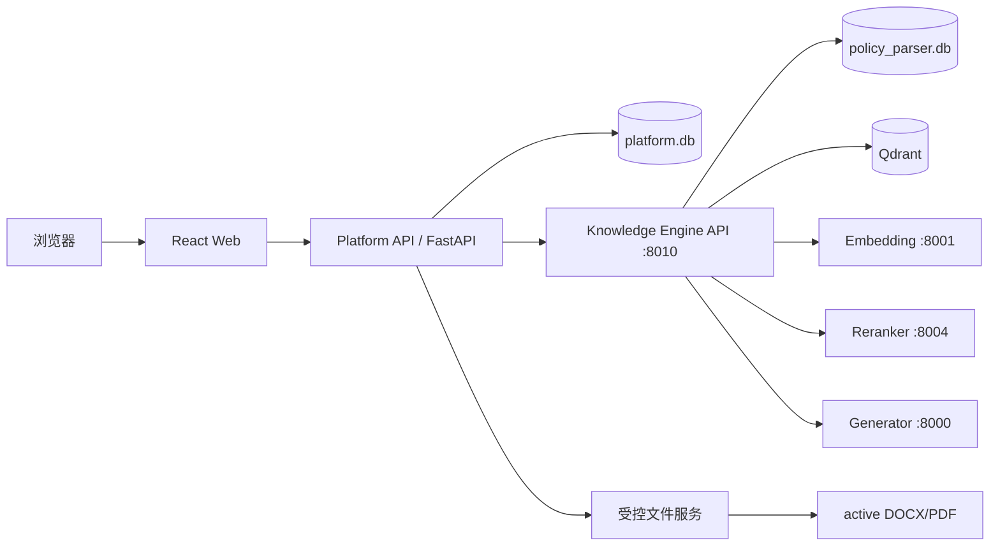

# 制度知识智能服务平台开发设计文档

> **迁移后说明（2026-08-29）**：本文保留为第一期产品设计和历史决策背景。
> 其中“`D:\2-code\rag` 独立运行、Platform 通过 8010 HTTP 调用、制度投影写入 Platform
> 数据库”的部署与数据访问方案，已由
> [ADR-0002：统一知识模块](decisions/ADR-0002-UNIFIED-KNOWLEDGE-MODULE.md)取代；问答运行边界以
> [ADR-0004：进程内 RAG 查询](decisions/ADR-0004-IN-PROCESS-RAG-QUERY.md)为准。
> 页面目标、回答状态、Citation、反馈、latest/active 审核规则仍然有效；当前工程事实以
> [PROJECT_HANDOFF](PROJECT_HANDOFF.md)和[文档处理模块规划](DOCUMENT_PROCESSING_MODULE_PLAN.md)为准。

**版本：V2.3（Codex开发基线稿）**  
**日期：2026-08-23**  
**适用范围：Windows项目机试运行 → 单位内网试点 → 生产化建设**

---

## 1. 文档结论

### 1.1 建设方式

采用“**新建产品工程，复用现有知识引擎**”的方式建设，不在现有`rag`目录中继续堆叠前端、
用户、会话、测评和管理后台代码，也不重写已经完成的Parser、Chunk、Index和RAG模块。

建议形成两个边界清晰的工程：

```text
D:\2-code\rag                    已完成的制度知识引擎
├── policy_parser                 DOCX解析
├── Chunk模块                     结构化切块
├── policy_index                  Embedding、Qdrant、Dense、Rerank
├── policy_rag                    Context、Citation、Generator、Parser
└── rag_api                       内部知识引擎API，默认127.0.0.1:8010

D:\2-code\policy-platform        新建的产品工程
├── frontend                      React + TypeScript + Ant Design
├── backend                       FastAPI平台API
├── migrations                    平台业务数据库迁移
├── docs                          产品、接口、部署和验收文档
└── tests                         平台测试
```

这里的“新建项目”是新建产品壳和业务系统，不是重新实现解析、检索与问答算法。平台后端通过内部
HTTP契约调用现有知识引擎；现有项目继续保持可独立测试、可独立升级、可独立回滚。

### 1.2 文档解析是否放入系统

解析能力应进入平台的“制度入库工作流”，但**解析算法不进入Web请求进程**。

正确结构是：

```text
管理后台上传DOCX
      ↓
保存到pending区并做SHA-256/格式预检
      ↓
创建ingestion_job
      ↓
后台Worker调用现有Parser/Chunk/Indexer
      ↓
人工审核ParseRun与ChunkRun
      ↓
人工执行激活
      ↓
发布新的active IndexRun与Qdrant alias
```

第一期平台只读现有20份active制度，仍使用当前命令行完成解析、审核、Chunk和索引。第二期再把
“上传、任务状态、报告查看、人工审核、激活”接入管理后台。任何上传都不得在一次HTTP请求中同步
完成解析；任何新运行也不得自动替代active运行。

### 1.3 三期总体目标

| 期次 | 核心目标 | 使用范围 | 主要成果 |
|---|---|---|---|
| 第一期 | 可用的制度查询与浏览平台 | Windows本机/受控演示 | 智能问答、会话、制度库、详情、PDF、Citation跳转 |
| 第二期 | 可管理、可审核的制度资产平台 | 单位内网小范围试点 | 登录权限、文档入库、版本关系、流程抽取与人工审核 |
| 第三期 | 可生产运行的知识服务平台 | 正式用户 | MySQL、密级过滤、审计监控、学习测评、部署与灾备 |

---

## 2. 项目定位与原则

### 2.1 产品定位

平台以制度文档为核心资产，提供四条业务链：

```text
查制度：制度库 → 筛选 → 制度详情 → 结构化正文/PDF
问制度：智能问答 → Citation → 证据面板 → 原文定位
懂制度：制度关系 → 版本链 → 流程 → 责任节点
学制度：题库 → 练习/考试 → 解析 → 依据条款
```

AI问答是入口之一，所有结论必须能够回到制度、条款、页码和原始文件。

### 2.2 不可破坏的技术原则

1. `policy_document`是制度资产主实体；
2. ParseRun、ChunkRun、IndexRun各自拥有独立latest/active指针；
3. 产品平台只能读取active数据，不能把latest当作active；
4. Qdrant继续属于知识引擎，不成为平台业务数据库；
5. LLM只输出E编号，制度名、文号、条款、页码由程序生成；
6. 原始DOCX、接受修订版DOCX和PDF不能被平台覆盖；
7. 文档上传、解析、审核、激活和索引发布是异步、可审计的状态机；
8. 前端不直接连接SQLite、Qdrant或模型服务；
9. 平台后端不直接拼接模型Prompt，也不绕过现有RAG契约；
10. 生产环境的部门、密级和制度范围过滤必须在检索前下推，并在SQLite回读后再次校验。

---

## 3. 当前可复用基础

### 3.1 已有数据和能力

| 项目 | 当前状态 |
|---|---|
| active制度 | 20份，状态均为现行有效 |
| active PDF | 20份 |
| active IndexRun | Run 3，579/579 verified |
| Dense/Rerank | Dense Top20 → Rerank Top8 |
| Context/Citation | 8000-token证据预算、稳定`evidence_uid`、页码引用 |
| Generator | Qwen3.8-27B、关闭thinking、严格Schema |
| RAG API | `POST /v1/rag/query`，默认`127.0.0.1:8010` |
| 健康检查 | `/health/live`、`/health/ready` |
| 查询日志 | 项目内按日JSONL，测试阶段保存原始问题 |

2026-08-23补充状态：`rag_api_v1_1`与`answer_quality_gate_v1`已经实现。最新15题全部运行成功但
状态匹配14/15，命令P50/P95为`15.018s/25.623s`，其中Verifier是主要新增耗时；`DEV-092`存在
PARTIAL降级待审计。该问题不阻塞M0/M1，需在M3智能问答验收和正式SLA冻结前完成优化与复测。

### 3.2 当前实际核心表

现有表名采用单数形式，产品设计必须以真实结构为准：

- `policy_document`
- `parse_run`
- `policy_node`
- `chunk_run`
- `policy_chunk`
- `chunk_source_node`
- `index_profile`
- `index_run`
- `index_run_source`
- `chunk_index_record`

当前没有`policy_relations`、`policy_files`、会话、流程或测评表。原设计中这些名称只能作为待开发
概念，不能假设数据库已经存在。

---

## 4. 总体架构

### 4.1 逻辑架构



### 4.2 两类数据库

第一期使用两个SQLite文件：

| 数据库 | 所有者 | 保存内容 | 写入方 |
|---|---|---|---|
| `policy_parser.db` | 知识引擎 | 文档、运行、Node、Chunk、索引控制面 | 现有流水线 |
| `platform.db` | 产品平台 | 用户、会话、消息、收藏、反馈、平台审计 | 平台后端 |

平台后端访问`policy_parser.db`时采用只读Repository。第一期可直接读取同机SQLite；中长期应由知识
引擎提供稳定的内部Document API，平台不依赖核心表的所有内部字段。

### 4.3 SQLite到MySQL的迁移原则

后期“切换MySQL”首先指迁移`platform.db`。现有`policy_parser.db`包含成熟的运行生命周期，不应
为了用户会话表而立即迁移。建议顺序：

1. 平台模型从第一天使用SQLAlchemy 2.x和Alembic；
2. 避免SQLite专有SQL和把JSON结构塞入无版本文本；
3. 第三期将平台业务库迁移到MySQL 8；
4. 为制度目录建立只读投影或内部API；
5. 是否迁移知识引擎控制库单独立项和验证，不与产品上线捆绑。

---

## 5. 产品功能架构

```text
制度知识智能服务平台
├── 首页
│   ├── 统一搜索/提问入口
│   ├── 最近更新制度
│   └── 常见问题
├── 智能问答
│   ├── 会话管理
│   ├── 单轮制度问答
│   ├── 会话内问题改写
│   ├── 答案与状态
│   └── Citation证据面板
├── 制度库
│   ├── 检索与筛选
│   ├── 制度列表
│   ├── 制度详情/目录/正文
│   ├── PDF预览与页码跳转
│   └── 原文件下载控制
├── 制度资产管理
│   ├── 入库任务
│   ├── 解析/Chunk审核
│   ├── 激活与索引发布
│   └── 版本与关系
├── 制度流程
│   ├── 流程抽取
│   ├── 人工审核
│   └── 流程图与条款依据
├── 学习测评
│   ├── 题库
│   ├── 练习/考试
│   └── 错题与依据回溯
└── 系统管理
    ├── 用户与角色
    ├── 部门/密级权限
    ├── 日志与反馈
    └── 运行监控
```

---

## 6. 新产品工程结构

建议新建一个Git仓库或独立目录`policy-platform`：

```text
policy-platform/
├── frontend/
│   ├── src/
│   │   ├── api/                 OpenAPI生成或手写的类型化客户端
│   │   ├── components/          Citation、PDF、状态等通用组件
│   │   ├── layouts/             主布局、管理布局
│   │   ├── pages/
│   │   │   ├── home/
│   │   │   ├── chat/
│   │   │   ├── documents/
│   │   │   └── admin/
│   │   ├── routes/
│   │   ├── stores/
│   │   ├── types/
│   │   └── utils/
│   ├── package.json
│   └── vite.config.ts
├── backend/
│   ├── app/
│   │   ├── api/v1/              路由层
│   │   ├── application/         用例编排
│   │   ├── domain/              会话、文档目录、反馈等领域模型
│   │   ├── infrastructure/
│   │   │   ├── db/              platform.db Repository
│   │   │   ├── knowledge/       8010知识引擎客户端
│   │   │   └── files/           PDF/DOCX安全访问
│   │   ├── schemas/             Pydantic公开契约
│   │   ├── config.py
│   │   └── main.py
│   ├── migrations/
│   └── tests/
├── docs/
│   ├── api/
│   ├── decisions/               ADR架构决策记录
│   └── deployment/
├── scripts/
└── README.md
```

第一期不采用微前端、Kubernetes、消息中间件、Redis、Elasticsearch或知识图数据库。达到明确的
并发、任务或图查询瓶颈后再引入，避免为20份制度过度设计。

### 6.1 前端技术栈冻结

一期前端采用`React + TypeScript + Ant Design`，最低支持Chrome 89内核。以下是一期工程基线，
创建工程时使用精确版本并提交
`pnpm-lock.yaml`，不得使用`latest`或不受控的`^`升级：

| 类别 | 冻结版本 | 选择理由 |
|---|---:|---|
| Node.js | 22.23.2 | 本机NVM已安装，写入`.nvmrc`并在开发前执行`nvm use 22.23.2` |
| pnpm | 11.22.0 | 本机已安装，`package.json`写入`packageManager` |
| React / React DOM | 18.3.1 | 成熟稳定，避免React 19与旧浏览器兼容面继续扩大 |
| TypeScript | 5.9.3 | 使用成熟的5.x工具链，不在一期采用TypeScript 7 |
| Ant Design | 5.29.3 | 保留AntD 5的旧浏览器降级能力；不采用AntD 6 |
| Ant Design X | 1.6.1 | 只用于聊天交互组件；不采用依赖AntD 6语义的2.x |
| Ant Design Icons | 5.3.1 | 与AntD 5基线保持同代 |
| React Router DOM | 6.30.6 | 使用稳定的v6路由API，不在一期引入v7/v8迁移成本 |
| TanStack React Query | 5.101.4 | 统一服务端状态、缓存、重试和请求取消 |
| Vite | 6.4.3 | 保守使用成熟版本并显式构建到Chrome 89，不追随Vite 8 |
| `@vitejs/plugin-react` | 5.1.3 | React 18与Vite 6工程插件 |

上述版本是项目开发基线。第一次创建工程时先制作包含路由、表格、抽屉、表单、弹窗、聊天气泡和
PDF入口的浏览器基线冒烟页，通过Chrome 89或对应内核的实际办公浏览器验收后
冻结lockfile。当前Codex PowerShell尚未初始化NVM环境，命令行中暂时无法解析`node`；这不否定用户
已安装的版本，创建工程前在该终端执行`nvm use 22.23.2`并确认`node -v`、`pnpm -v`即可，不需要重装。

### 6.2 Chrome 89浏览器基线

AntD 5的`:where`最低支持Chrome 88，CSS逻辑属性最低支持Chrome 89，因此项目统一把**Chrome 89**
作为最低版本，不再为即将淘汰的Chrome 69增加legacy双构建和CSS降级代码。

执行以下规则：

1. `vite.config.ts`设置`build.target: 'chrome89'`；Browserslist设置`Chrome >= 89`；
2. 不安装`@vitejs/plugin-legacy`，不生成SystemJS legacy包；
3. 兼容验收使用`pnpm build`后的产物，不能只用Vite开发服务器判断；
4. 业务代码避免无必要地采用更新浏览器专属API；新增API必须经过Chrome 89兼容检查；
5. PDF优先使用浏览器原生查看；办公浏览器禁用内嵌PDF时降级为受控新窗口打开；
6. Chrome 89基线浏览器和当前Chrome/Edge稳定版分别执行最小冒烟测试。

Ant Design X 2.x迁移说明要求优先升级到AntD 6。本项目继续采用AntD 5 + Ant Design X 1.6.1，
避免在一期同时承担UI大版本升级和产品功能开发风险。

### 6.3 Ant Design X使用边界

Ant Design X适合本项目，但只作为**聊天界面组件库**，不能替代业务API、状态管理或证据系统：

- 使用`Conversations`、`Bubble.List`、`Sender`、`Actions`、`Prompts`构建会话区；
- 不使用X SDK直接访问模型，所有请求仍由Platform API调用Knowledge Engine；
- 不使用Ant Design X 2.x的`Sources`、XMarkdown等能力；
- Citation证据面板使用AntD `Drawer/List/Card/Descriptions/Typography/Tag`自行实现，后端证据契约是唯一事实源；
- 如果Chrome 89基线冒烟发现Ant Design X 1.6.1存在不兼容组件，聊天区改用AntD
  `List/Card/Input.TextArea/Button`实现，API契约和页面结构不变。

一期不采用Ant Design Pro：当前页面和权限范围不需要其脚手架，额外依赖会扩大兼容验证面。

---

## 7. 第一期：制度查询与问答试运行版

### 7.1 第一期目标

用现有20份active制度完成一条真实闭环：

```text
用户进入平台
  → 搜索或选择制度
  → 阅读结构化正文/PDF
  → 提出制度问题
  → 获得带Citation的答案
  → 点击E编号打开证据
  → 跳到对应制度、条款和PDF页码
  → 对答案有用/无用进行反馈
```

第一期是只读制度知识服务。文档解析、Chunk审核和索引激活继续由现有命令行流程完成。

### 7.2 第一期必须完成的页面

#### 7.2.1 应用框架

- 左侧或顶部主导航：智能问答、制度库；
- 全局错误页、404、服务不可用提示；
- 后端ready状态提示；
- 统一主题、中文日期和空状态；
- 支持最低Chrome 89内核和当前Chrome/Edge稳定版；兼容性以生产构建产物测试为准。

#### 7.2.2 首页

第一期首页保持简洁：

- 一个统一输入框，可选择“搜索制度”或“询问制度”；
- 最近更新制度；
- 预设的常见问题入口；
- 服务当前是否可用。

热门制度、个人最近学习等依赖真实用户数据的模块暂不伪造。

首页采用“顶部导航 + 主搜索区 + 常见问题 + 最近更新”结构：

```text
┌──────────────────────────────────────────────────────────────┐
│ 平台名称       首页   智能问答   制度库          服务状态 ●   │
├──────────────────────────────────────────────────────────────┤
│                                                              │
│                 制度知识智能服务平台                          │
│          基于当前有效制度提供查询、问答与原文引用              │
│                                                              │
│        [ 搜索制度 | 询问制度 ]                                │
│        [ 输入制度名称、文号或问题……              ] [提交]      │
│                                                              │
├──────────────────────────┬───────────────────────────────────┤
│ 常见问题                  │ 最近更新制度                       │
│ · 异地交流住房怎么申请？   │ 制度名 / 文号 / 更新时间 / 状态     │
│ · 哪些情况可以报销？       │ 点击进入制度详情                    │
└──────────────────────────┴───────────────────────────────────┘
```

交互规则：

1. 选择“搜索制度”后提交，跳转`/documents?keyword=...`；
2. 选择“询问制度”后提交，后端创建会话并跳转`/chat/:sessionId`；
3. 常见问题由管理员配置或前端配置文件提供，点击后进入问答，不伪造热度；
4. 最近更新默认显示5条active制度，按`updated_at`倒序；
5. 服务不可用时保留制度库入口，问答输入框禁用并显示原因；
6. 首页不展示“制度总数、回答准确率、累计用户”等缺乏可信统计口径的数字。

#### 7.2.3 智能问答页

采用三栏布局：会话列表、消息区、证据面板。

必须实现：

1. 新建、重命名和删除会话；
2. 用户消息和助手消息持久化；
3. 发送中、失败、重试、取消显示；
4. `ANSWER/INSUFFICIENT_EVIDENCE/CONFLICT`三种状态的不同呈现；
5. `[E1]`点击后选中右侧证据；
6. 证据显示制度名、文号、状态、条款路径、页码和原文；
7. “查看完整制度”跳转详情页并定位Node；
8. “查看PDF”打开对应页；
9. 复制答案时保留引用编号；
10. 点赞、点踩及可选文字反馈；
11. 明确展示“答案仅依据当前制度库”。

第一期默认单轮问题直接调用现有`/v1/rag/query`。会话历史用于展示和数据收集。多轮Query
Rewrite作为第一期后半段的独立功能开关，先用专项测试证明不会改变原问题含义后再默认开启。

#### 7.2.4 制度库

支持以下查询参数：

- 关键词：标题、文号、发布机构、正文；
- 状态；
- 发布机构；
- 责任部门；
- 发布/生效日期区间；
- 分页和排序。

20份制度规模下可先用SQLite FTS5或受控`LIKE`查询。需要正文关键词搜索时优先使用FTS5；
Qdrant负责语义问答，不替代制度列表的确定性筛选。

列表展示：制度名称、文号、发布机构、发布日期、生效日期、状态、责任部门和更新时间。

#### 7.2.5 制度详情页

必须包含：

- 标题、文号、发布机构、日期、状态；
- 按active ParseRun读取的树形目录；
- 按`order_no`展示结构化正文；
- Node锚点，例如`node-{node_id}`；
- 页码和条款路径；
- PDF预览；
- Citation传入的`document_id/node_id/page`定位；
- 原始文件受控下载入口是否显示由配置决定。

前端不得提交任意服务器文件路径。PDF接口接收`document_id`，后端根据active ParseRun中的
`pdf_path`查找文件并验证路径位于允许目录。

### 7.2.6 一期路由、页面和组件清单

一期页面不再留给开发时临时决定，按下表实现。业务组件统一使用AntD；Ant Design X只出现在
智能问答的聊天交互区。一期共**7个功能页面、9个路由状态**：`/chat`和`/chat/:sessionId`属于同一个
智能问答页面的空会话、已有会话两种状态；RAG诊断列表和详情属于一个开发诊断模块。

| 路由 | 页面职责 | 主要组件 | 一期验收重点 |
|---|---|---|---|
| `/` | 首页与统一入口 | `Layout`、`Input.Search`、`Segmented`、`Card`、`List`、`Tag`、`Alert`、`Skeleton` | 搜索/问答分流明确，服务异常可见 |
| `/chat` | 新会话 | X `Prompts`、`Sender`；AntD `Result`、`Alert` | 可选常见问题并发起新会话 |
| `/chat/:sessionId` | 会话问答 | X `Conversations`、`Bubble.List`、`Sender`、`Actions`；AntD `Button`、`Tooltip`、`Result` | 三状态、重试、引用点击、刷新恢复 |
| `/documents` | 制度库 | `Form`、`Input`、`Select`、`DatePicker.RangePicker`、`Table`、`Pagination`、`Tag`、`Empty` | URL保留筛选条件，正文FTS5可用 |
| `/documents/:documentId` | 制度详情 | `Breadcrumb`、`Descriptions`、`Tabs`、`Tree`、`Anchor`、`Typography`、`Tag`、`Button` | active正文、Node和页码定位准确 |
| `/documents/:documentId/pdf?page=N` | PDF查看 | 原生`iframe/object`、`Spin`、`Result`、新窗口降级按钮 | PDF路径不暴露，页码尽力定位 |
| `/settings/about` | 版本与服务说明 | `Descriptions`、`Badge`、`Alert` | 展示平台版本、知识库更新时间和服务状态，不显示密钥/路径 |
| `/diagnostics/requests` | RAG诊断列表 | `Form`、`Table`、`Tag`、`DatePicker`、`Pagination` | 按request_id、状态、反馈和日期检索 |
| `/diagnostics/requests/:requestId` | RAG诊断详情 | `Steps`、`Tabs`、`Table`、`Descriptions`、`Collapse`、`Alert` | 定位召回、重排、Context、Generator或Citation阶段问题 |

智能问答右侧证据面板是自研`EvidencePanel`，使用`Drawer`或固定侧栏承载：

- `Collapse/List`组织E1、E2等证据；
- `Descriptions/Tag`显示制度名、文号、状态、条款路径和页码；
- `Typography.Paragraph`只展示后端返回的原文；
- “定位正文”和“打开PDF”按钮只传`document_id/node_id/page`；
- 不解析或相信LLM自由生成的制度名、文号和页码。

### 7.2.7 一期页面布局基线

一期以`1440×900`办公桌面为主要验收尺寸：

```text
智能问答页
┌──────────────┬──────────────────────────────┬────────────────────┐
│ 会话列表      │ 消息区                        │ 证据面板            │
│ 240～280px    │ min-width: 600px             │ 360～420px          │
│ 新建/搜索/列表 │ Bubble.List                   │ E1/E2/条款/PDF       │
│               │ Sender固定在消息区底部         │                    │
└──────────────┴──────────────────────────────┴────────────────────┘
```

使用Flex布局。窗口宽度低于1200px时，会话列表和证据面板改为`Drawer`，消息区保持可用；一期不以手机端
作为验收目标。颜色、间距、圆角和字号由AntD theme token统一管理，不在页面中散落魔法值。

### 7.2.8 二、三期预留页面

以下路由一期只保留导航和权限扩展位置，不创建空壳页面：

| 阶段 | 路由 | 页面 |
|---|---|---|
| 二期 | `/admin/documents` | 制度资产管理 |
| 二期 | `/admin/ingestion`、`/admin/ingestion/:jobId` | 入库任务列表、进度和产物审核 |
| 二期 | `/admin/reviews` | ParseRun、ChunkRun和激活审核工作台 |
| 二期 | `/admin/relations` | 引用、替代、废止关系审核 |
| 二期 | `/admin/processes`、`/admin/processes/:id/editor` | 流程列表、人工编辑和版本审核 |
| 二期 | `/admin/audit` | 管理操作审计 |
| 三期 | `/learn`、`/learn/practice`、`/learn/exams`、`/learn/wrong-questions` | 学习、练习、考试和错题 |
| 三期 | `/admin/question-bank` | 题库生成、编辑和审核 |
| 三期 | `/admin/users`、`/admin/roles` | 管理账号、本地角色及后续4A映射 |

### 7.2.9 RAG诊断页面边界

诊断页一期后半段实现，开发期仅在`127.0.0.1`且`RAG_DIAGNOSTICS_ENABLED=true`时开放；进入局域网
或生产环境后必须改为管理员权限。页面按同一`request_id`展示：

```text
原问题 → Query Rewrite → Dense Top20 → Rerank Top8
       → Context选择/去重/丢弃原因 → Generator草稿
       → 问答质量门禁 → 最终状态与Citation
```

诊断数据包含rank、score、chunk_id、运行版本、证据选择和门禁原因，但不展示模型reasoning、密钥、
服务器绝对路径。被门禁拦截的Generator草稿只供受控诊断使用，不能作为答案返回普通用户。

### 7.3 第一期后端模块

| 模块 | 职责 |
|---|---|
| `ChatApplicationService` | 会话、消息、RAG调用、Citation落库、反馈 |
| `KnowledgeEngineClient` | 调用8010，透传request_id，处理固定错误码 |
| `DocumentQueryService` | 只读active制度和Node，完成筛选、目录和锚点定位 |
| `FileAccessService` | 以document_id安全提供PDF/DOCX，不接受路径参数 |
| `HealthService` | 聚合平台DB、知识引擎和文件目录状态 |
| `AuditService` | 记录平台操作、耗时与错误，不保存密钥和Prompt |

### 7.4 第一期API清单

平台前端只访问Platform API，建议前缀`/api/v1`：

#### 健康

```text
GET /api/v1/health/live
GET /api/v1/health/ready
```

#### 会话与问答

```text
POST   /api/v1/chat/sessions
GET    /api/v1/chat/sessions
PATCH  /api/v1/chat/sessions/{session_id}
DELETE /api/v1/chat/sessions/{session_id}
GET    /api/v1/chat/sessions/{session_id}/messages
POST   /api/v1/chat/sessions/{session_id}/messages
POST   /api/v1/chat/messages/{message_id}/feedback
```

发送消息后，Platform API调用内部知识引擎`POST http://127.0.0.1:8010/v1/rag/query`。第一期使用
普通JSON响应，不急于引入SSE；当前端确实需要逐字输出且Generator支持稳定流式结构后再新增流式端点。

#### 制度

```text
GET /api/v1/documents
GET /api/v1/documents/{document_id}
GET /api/v1/documents/{document_id}/nodes
GET /api/v1/documents/{document_id}/pdf
GET /api/v1/documents/{document_id}/files/original
```

`nodes`默认只返回active ParseRun，提供`node_id`定位，不允许前端自行指定历史ParseRun冒充正式正文。

### 7.5 第一期平台数据模型

平台表使用UUID字符串作为对外ID，内部可使用自增主键。所有时间统一保存UTC。

#### `chat_session`

| 字段 | 说明 |
|---|---|
| `id` | UUID |
| `title` | 会话标题 |
| `created_by` | 第一期可为空或固定local-user |
| `status` | active/deleted |
| `created_at/updated_at` | UTC时间 |

#### `chat_message`

| 字段 | 说明 |
|---|---|
| `id` | UUID |
| `session_id` | 会话外键 |
| `role` | user/assistant |
| `content` | 原始问题或公开答案 |
| `answer_status` | 三状态，用户消息为空 |
| `request_id` | Platform请求ID |
| `engine_request_id` | 8010内部请求ID |
| `rag_version` | RAG流水线版本 |
| `generator_model` | Generator模型名称和冻结revision |
| `prompt_schema_version` | Prompt及严格输出Schema版本 |
| `retrieval_profile` | Dense、Rerank、Context预算等配置档案名/哈希 |
| `index_run_id` | 回答生成时实际使用的IndexRun |
| `rewrite_used` | 是否执行Query Rewrite及其版本 |
| `quality_gate_version/status` | 问答质量门禁版本及PASS/DOWNGRADED |
| `latency_ms` | 总耗时 |
| `created_at` | UTC时间 |

#### `message_citation`

| 字段 | 说明 |
|---|---|
| `id` | 主键 |
| `message_id` | 助手消息外键 |
| `citation_label` | E1/E2 |
| `evidence_uid` | 稳定证据ID |
| `citation_version/evidence_uid_version` | Citation契约及稳定ID算法版本 |
| `document_id/primary_node_id` | 制度和主要Node定位ID |
| `parse_run_id/chunk_run_id/index_run_id` | 回答当时使用的解析、切片和索引运行 |
| `chunk_id` | 回答当时使用的Chunk主键 |
| `document_title/document_code` | 响应时快照 |
| `document_status` | 回答时制度状态快照 |
| `path_text` | 条款路径快照 |
| `page_start/page_end` | 页码快照 |
| `quote` | 证据原文快照 |
| `source_reference` | 相对来源引用 |
| `snapshot_hash` | 对关键快照字段计算的完整性哈希 |

现有RAG内部`EvidenceRecord`已经包含`document_id`、`primary_node_id`、`parse_run_id`、`chunk_run_id`、
`index_run_id`和`chunk_id`，当前缺口主要在公开API裁剪层和平台持久化层。第一期开发前扩展知识引擎
版本化Citation响应并保存完整快照，不需要重做Context Builder或Citation Registry。

历史会话默认展示保存时的`quote/path_text/page/document_title/status`快照。若当前active ParseRun与
保存的`parse_run_id`不同，界面必须提示“当前制度版本已变化”，分别提供“查看回答时证据快照”和
“查看当前有效制度”；不得悄悄把历史E1跳转到新版本原文。

#### `message_feedback`

| 字段 | 说明 |
|---|---|
| `id` | 主键 |
| `message_id` | 助手消息外键 |
| `rating` | up/down |
| `primary_reason_code` | 主要问题原因 |
| `comment` | 可选文字 |
| `mark_as_eval_case` | 是否提交为候选评测案例；后端据此创建`eval_candidate`，不只保存布尔值 |
| `created_at` | UTC时间 |

反馈原因采用受控枚举，并允许通过`message_feedback_reason`关联多个原因：

- `retrieval_miss`：未召回正确制度；
- `citation_mismatch`：Citation不能支撑答案；
- `answer_wrong_with_valid_citation`：引用正确但回答错误；
- `answer_incomplete`：回答不完整；
- `inactive_document_used`：引用了失效制度；
- `query_misunderstood`：问题理解错误；
- `conflict_mishandled`：多制度冲突处理错误；
- `other`：其他。

`eval_candidate`至少保存原问题、原回答、Citation快照、反馈原因、人工修正、预期制度/Node、审核状态和
来源request_id。状态采用`CANDIDATE/REVIEWED/ACCEPTED/REJECTED`；只有管理员审核为`ACCEPTED`后才
进入独立回归集。

#### `platform_audit_log`

记录request_id、动作、对象、状态、耗时和错误码。第一期没有真实账号时`actor_id`使用固定测试身份，
不得伪装成已实现认证。

### 7.6 第一期前端状态设计

- 服务状态：TanStack Query管理服务端缓存；
- 页面轻状态：React组件状态或轻量Store；
- 会话消息发送：使用客户端临时ID，成功后替换为服务器ID；
- 同一会话一次只允许一个生成中的请求；
- 页面刷新后从后端恢复消息，不依赖浏览器内存；
- Citation选中状态放在URL查询参数中，允许复制带定位链接；
- PDF页码、Node锚点和证据编号需要形成统一`CitationTarget`类型。

### 7.7 第一期错误与用户提示

| Engine错误 | Platform行为 | 前端提示 |
|---|---|---|
| `QUEUE_FULL` | 返回429并保留request_id | 当前请求较多，请稍后重试 |
| `UPSTREAM_UNAVAILABLE` | 返回503 | 模型服务暂不可用 |
| `UPSTREAM_CIRCUIT_OPEN` | 返回503并显示可重试 | 服务正在恢复，请稍后重试 |
| `ANSWER_VALIDATION_FAILED` | 返回502，不保存伪答案 | 答案校验未通过，请重试 |
| `REQUEST_TIMEOUT` | 返回504 | 本次处理超时 |
| `INSUFFICIENT_EVIDENCE` | 正常200业务结果 | 当前制度资料不足以确定 |
| `CONFLICT` | 正常200业务结果 | 展示不同规定及各自证据 |

### 7.8 第一期安全边界

第一期无登录仅适用于本机或受控演示：

1. Platform API和Knowledge Engine都只监听`127.0.0.1`；
2. 使用Vite代理或同源反向代理，避免开放任意CORS；
3. 文件接口只接收ID并验证允许根目录；
4. 不向前端返回`source_file/pdf_path`绝对路径；
5. 不向浏览器返回模型地址、密钥、Prompt、reasoning和内部异常栈；
6. 上传与删除功能不进入无认证的第一期；
7. 原始问题日志继续按用户已确认的测试规则保存。

### 7.9 第一期测试和验收

开发过程中执行与修改相关的最小单元测试；完整端到端和压力测试由用户在验收时手动执行。

必须验收的业务场景：

1. 新建会话并完成一次ANSWER问答；
2. 不可回答题正确显示证据不足；
3. Citation E1点击后显示正确制度、条款、页码和原文；
4. 从Citation跳到制度详情正确Node；
5. 从Citation打开PDF正确页；
6. 制度库标题、文号、部门、日期、状态筛选正确；
7. 刷新页面后会话和消息不丢失；
8. 8010关闭时Platform ready为503且前端提示明确；
9. 文件接口无法使用`../`或任意绝对路径读取文件；
10. API响应和日志中不存在密钥、Prompt、reasoning和服务器绝对路径。
11. Generator草稿含未知E编号、缺少Citation或证据不支撑结论时，质量门禁强制降级；
12. 历史会话在active ParseRun变化后仍展示原Citation快照，并提示版本已变化。

第一期完成定义：

- 20份active制度全部能浏览结构化正文和PDF；
- 120题开发集涉及的Citation能够定位到制度详情；
- 第一批用户问题可通过会话、日志和反馈回收；
- 解析、Chunk、Index和Qdrant运行指针保持不变；
- 部署、启动、停止、备份和故障处理有可执行文档。

### 7.10 第一期明确不做

- 浏览器上传和自动解析；
- 制度关系图、流程自动抽取；
- 学习测评；
- 多租户、部门和密级权限；
- 跨会话长期Memory和用户画像；
- 自动联网补充制度；
- 前端直接选择Dense/Rerank/模型参数；
- MySQL、Redis、消息队列、Kubernetes；
- 把现有CLI逻辑复制到Platform API。

### 7.11 第一期Codex开发里程碑

本文不按人员和工期排期。Codex按依赖顺序逐个里程碑开发，每个里程碑满足退出条件后再进入下一项：

| 里程碑 | 内容 | 退出条件 |
|---|---|---|
| M0 | Chrome 89浏览器基线冒烟 | 基线浏览器通过生产构建冒烟；冻结`pnpm-lock.yaml` |
| M1 | 新产品工程、平台DB、API骨架、前端布局、契约联调 | 前后端可启动；health可用；OpenAPI契约可生成类型 |
| M2 | 制度列表、详情、Node目录、PDF安全访问 | active制度可筛选、浏览并定位；路径越界测试通过 |
| M3 | 会话、消息、8010代理、三状态和质量门禁 | 三类答案可稳定保存和恢复；无支撑草稿不能公开 |
| M4 | Citation快照、Node/PDF定位、反馈与诊断 | 历史E编号可审计；反馈可进入候选评测集；请求链可诊断 |
| M5 | 最小测试、20份制度验收、部署与操作文档 | 一期完成定义全部满足，未执行的耗时测试有人工命令 |

---

## 8. 第二期：制度资产管理与知识关联

### 8.1 目标

把平台从只读查询工具扩展为内网制度资产管理试点，并在任何自动处理之后保留人工审核和激活。

### 8.2 功能范围

1. 管理账号、基础角色和登录；暂不实现部门范围或密级过滤；
2. 制度上传、入库任务、进度和错误报告；
3. ParseRun、ChunkRun审核页面；
4. 人工激活和IndexRun发布；
5. 制度版本、引用、替代、废止和同主题关系；
6. 流程类条款识别、LLM结构化抽取、人工审核和流程图；
7. 多轮Query Rewrite，冻结重写契约和专项评测；
8. 管理后台操作审计。

### 8.3 入库任务数据模型

平台业务库增加：

- `ingestion_job`
- `ingestion_job_event`
- `ingestion_artifact`
- `review_assignment`

任务只保存外部编排状态和核心运行ID，不复制Parser/Chunk内部明细。建议状态：

```text
UPLOADED → PREFLIGHT_PASSED → PARSING → PARSE_REVIEW
         → CHUNKING → CHUNK_REVIEW → INDEXING → READY_TO_ACTIVATE
         → ACTIVE
```

任意阶段可以进入`FAILED`或`CANCELLED`。激活必须由有权限的人工操作触发，并写审计记录。

### 8.4 制度关系模型

新增关系实体时至少保存：

- `source_document_id`
- `target_document_id`
- `relation_type`
- `source_node_id`
- `evidence_text`
- `valid_from/valid_to`
- `review_status`
- `created_by/reviewed_by`

关系类型采用受控枚举：`CITES/SUPERSEDES/REPEALS/RELATED_TOPIC/CONFLICTS_WITH`。LLM提取只能生成
候选关系，人工审核后才成为正式关系。冲突关系不能仅凭语义相似自动确认。

### 8.5 制度流程模型

建议使用规范化表：

- `policy_process`
- `process_node`
- `process_edge`
- `process_evidence`
- `process_revision`

不要在`policy_process`中用一个`source_node_ids`文本字段保存全部依据；一条流程节点可能对应多条
制度证据，需要独立证据映射表。

流程图由管理员配置和最终确认，支持三类输入来源：

1. 管理员在画布中人工新建节点、连线、条件、责任角色和说明；
2. 从制度文档中抽取流程候选，每个节点和连线保留`document_id/node_id/page`证据；
3. 从经批准的结构化数据库导入候选，并保存来源系统、业务主键和导入批次。

自动抽取或数据库导入都只能创建`DRAFT`修订版，管理员在编辑器中补充、纠错并发布为`PUBLISHED`。
发布后仍保留旧修订版和证据映射。前端流程编辑器采用AntV X6，关系只读图采用ECharts；二期开始时
分别对拟用版本做Chrome 89生产构建冒烟，通过后才冻结版本，不在一期提前安装依赖。

### 8.6 第二期验收重点

- 上传任务可恢复、可查看进度、失败不污染active数据；
- 未审核运行不能激活；
- 新IndexRun发布失败时旧alias仍可用；
- 每条正式关系和流程节点都能回到制度、Node和页码；
- 普通用户看不到管理功能和未激活数据；
- 多轮重写不改变用户约束、否定和主体。

---

## 9. 第三期：生产化与学习测评

### 9.1 生产化

1. Platform业务库迁移MySQL 8；
2. 统一身份认证，后期对接单位4A；
3. 管理账号和基础角色先行；部门、密级和制度范围规则待单位规则明确后独立建设；
4. Qdrant检索前过滤与SQLite回读后二次校验；
5. HTTPS、反向代理、Windows服务或容器编排；
6. 平台自身提供结构化日志和基础运行状态；暂不对接外部日志或监控平台；
7. 日志脱敏、保留周期、归档和删除审计；
8. SQLite/MySQL、Qdrant storage、原始文件和配置的备份恢复演练；
9. 独立验收集、不可回答专项集、冲突专项集和真实问题回归；
10. 根据GPU监控冻结vLLM并发参数。

### 9.2 学习测评

学习题目分为“人工维护”和“AI候选”两类。AI生成题目必须经过审核才能进入正式题库。

建议实体：

- `question_bank`
- `quiz_question`
- `question_evidence`
- `quiz_paper`
- `quiz_paper_item`
- `quiz_attempt`
- `quiz_answer`
- `wrong_question_record`

每道题至少绑定`document_id`、`node_id`、证据快照、正确答案、解析、生成模型/Prompt/Schema版本和
审核状态。制度版本失效时触发题目复核，不能继续把旧依据当作现行答案。

### 9.3 第三期验收重点

- 权限过滤在检索前后都生效，越权测试全部拒绝；
- MySQL迁移前后业务记录数量和关键哈希一致；
- 备份恢复后会话、制度、Qdrant alias和文件引用一致；
- 监控可以定位Platform API、Knowledge Engine、Qdrant和三个模型服务；
- 正式题库每题均有审核人与可追溯制度依据；
- 独立验收集与开发120题分离，人工结论不由同模型Judge替代。

---

## 10. 关键接口契约补充

### 10.1 Citation版本化契约

> 实施状态（2026-08-23）：Knowledge Engine的`rag_api_v1_1`公开Citation已经按本节冻结；
> 内部制度列表、Node和PDF元数据接口仍属于后续Platform工程。

第一期开始前，现有Knowledge Engine API建议增加内部只读接口：

```text
GET /internal/v1/documents
GET /internal/v1/documents/{document_id}
GET /internal/v1/documents/{document_id}/nodes
GET /internal/v1/documents/{document_id}/pdf-metadata
```

并把RAG Citation公开结构扩展为：

```json
{
  "citation_version": "citation_v1",
  "evidence_uid_version": "evidence_uid_v1",
  "label": "E1",
  "evidence_uid": "ev_...",
  "document_id": 12,
  "primary_node_id": 345,
  "parse_run_id": 43,
  "chunk_run_id": 18,
  "index_run_id": 3,
  "chunk_id": 579,
  "document_title": "……",
  "document_code": "……",
  "document_status": "effective",
  "path_text": "第三章 / 第十二条",
  "page_start": 5,
  "page_end": 5,
  "quote": "……",
  "snapshot_hash": "sha256:……"
}
```

`document_id`和`primary_node_id`来自SQLite权威记录，不由LLM提供。这是Citation从证据面板稳定跳转到
制度详情的必要接口，不属于重新设计RAG。运行ID和Chunk ID由RAG内部模型直接透传给可信Platform
后端用于审计；Platform返回普通浏览器时只公开页面定位和展示所需字段。

### 10.2 问答质量门禁

> 实施状态（2026-08-23）：`answer_quality_gate_v1`已接入正式`RagRuntime`。离线契约与降级测试
> 已通过，真实单题、15题和120题仍需按交付命令验证。

问答质量门禁是一期P0能力，位于`Answer Parser/Citation Registry`之后、API公开响应和消息落库之前。
Generator只能提交答案草稿，最终`ANSWER/INSUFFICIENT_EVIDENCE/CONFLICT`由门禁程序决定。

建设前并非完全没有门禁：现有`AnswerParser`已经校验ANSWER至少一个Citation、正文E编号与citations数组
一致、E编号属于本次Registry、重复引用以及CONFLICT至少两条不同证据；失败后Pipeline执行一次有限
重试。本次增量已补齐“每项关键结论都绑定证据”“Citation在语义上确实支撑结论”和“最终失败后
保守降级而不是公开答案”，并继续复用原有白名单与状态校验。

#### 硬性契约门禁

`ANSWER`必须同时满足：

1. 答案非空且至少有1条Citation；不设置机械的“至少2条”，单一权威条款可能足以支撑简单结论；
2. 答案中每项可核验的关键结论至少绑定一个`[E编号]`；列表项分别绑定，不允许只在全文末尾笼统引用；
3. 所有E编号都存在于本次`CitationRegistry`，不得引用未知、重复注册或其他请求的证据；
4. 返回的Citation集合与答案实际使用的E编号一致；
5. Citation包含稳定`evidence_uid`、版本链、制度/Node定位和非空原文快照；
6. 引用制度属于回答时的active IndexRun，状态符合检索过滤规则；
7. Generator不能提供或覆盖制度名、文号、页码和运行ID，全部由程序映射。

`CONFLICT`必须至少有两个明确立场，每个立场至少绑定一条能够支撑该立场的Citation。若只有一方有
证据，不得输出`CONFLICT`，应降级为`INSUFFICIENT_EVIDENCE`。

#### 语义支撑门禁

仅检查“E编号存在”不能证明证据支持结论。第一版由程序从答案中紧邻的`[E编号]`提取关键结论绑定，
并把CONFLICT每个结构化position单独加入校验；不扩大Generator公开Schema。门禁对每个绑定执行证据支撑校验，结果为
`SUPPORTED/PARTIAL/UNSUPPORTED`：

- 任一关键结论为`UNSUPPORTED`，强制降级为`INSUFFICIENT_EVIDENCE`；
- `PARTIAL`结论必须删除无支撑部分并重新校验，不能直接公开；
- 全部关键结论`SUPPORTED`后才允许`ANSWER`；
- 第一版可以使用确定性结构校验加严格Schema的独立Verifier调用；Verifier失败、超时或返回非法结构时
  采用保守失败，不能放行答案；
- Rerank分数只能用于排序，不能替代证据支撑判断。

发给8000的strict JSON Schema继续避免使用服务端不兼容的`uniqueItems`；数组唯一性由本地Parser校验。

门禁降级时，普通用户只看到“当前制度资料不足以支持可靠结论”；原Generator草稿、失败规则和证据
绑定保存在受控诊断记录中。不得出现“答案有具体内容但Citation对不上”的公开响应。

### 10.3 门禁版本与验收

每次回答保存`quality_gate_version`、规则结果和降级原因。120题开发集在答案评测之外增加：

- 关键结论Citation覆盖率；
- Citation语义支撑正确率；
- 未知E编号拦截率；
- 无Citation ANSWER拦截率；
- 不支持结论降级准确率；
- CONFLICT双边证据完整率。

发布门槛不以单一总分代替。上述硬性契约违规必须为0；语义门禁阈值在完成120题基线后冻结，并写入
版本化配置，不能在代码中散落临时数值。

---

## 11. 可观测性与数据反馈

### 11.1 统一request_id

浏览器生成或接收Platform `request_id`，Platform调用Knowledge Engine时继续透传。平台日志、知识
引擎日志、消息记录和用户反馈均可按request_id关联。

### 11.2 第一阶段建议指标

- 请求数、成功率、三状态分布；
- Platform P50/P95和Knowledge Engine P50/P95；
- 429/502/503/504错误数量；
- Citation数量和证据面板点击率；
- 答案点赞/点踩率；
- 制度详情、Node和PDF跳转成功率；
- 无结果搜索词；
- 真实问题收集量。

诊断记录按request_id保存原问题、Rewrite、Dense/Rerank排序、Context选择、Generator结构化草稿、
质量门禁结果和公开Citation。保留期与原始问题日志一致，测试期为90天。普通日志保留摘要，完整诊断
记录使用独立目录或表并限制访问，避免每条常规日志无限膨胀。

不建议把模型Rerank分数直接展示给普通用户，也不应把单一分数当作答案置信度。

---

## 12. 主要风险与控制

| 风险 | 控制方式 |
|---|---|
| 产品代码破坏成熟流水线 | 新建产品工程，知识引擎只通过版本化API暴露能力 |
| 两个服务直接共享可写SQLite | 平台对核心库只读；平台写入独立`platform.db` |
| Citation只能显示、不能跳转 | Engine Citation增加程序生成的document_id/node_id |
| Web同步解析导致超时 | 第二期采用异步ingestion_job和后台Worker |
| 新ParseRun意外替代正式数据 | 审核与激活分离，latest/active继续隔离 |
| 关系/流程被LLM编造 | 只生成候选，保存证据，人工审核后发布 |
| SQLite迁移拖累核心算法 | 先迁移平台业务库，知识引擎控制库单独立项 |
| 无认证系统被用于内网多人 | 第一期仅本机；进入内网前完成身份和权限 |
| 原始问题日志含敏感信息 | 当前受控测试保存；生产前冻结脱敏、权限和保留周期 |
| 前端过早依赖流式输出 | 第一版使用稳定JSON，流式能力单独评测后再增加 |

---

## 13. 已确认开发决策（2026-08-23）

本章替代原“一次性确认清单”。未特别修改的项目均采用原建议默认值，Codex后续开发应直接按本章
执行，不再重复询问已经确认的选择。

### 13.1 工程与运行基线

| 编号 | 已确认决策 |
|---:|---|
| 1 | 新建`D:\2-code\policy-platform`；当前`rag`保持独立知识引擎 |
| 2 | 单一仓库包含`frontend/backend/docs`，前后端物理目录分离 |
| 3 | 不制定人员配置和工期；本文是Codex分阶段开发与验收依据 |
| 4 | 使用pnpm |
| 5 | 本机NVM、Node 22.23.2、pnpm 11.22.0；工程冻结版本和lockfile |
| 6 | 一期仅在当前Windows项目机测试 |
| 7 | 一期无登录，使用固定`local-user`，只监听本机地址 |
| 8 | 应用层问答并发上限先按4设计 |
| 9 | 最低支持Chrome 89内核；少量Chrome 69设备不进入兼容范围；主要验收分辨率1440×900 |

### 13.2 一期产品行为

| 编号 | 已确认决策 |
|---:|---|
| 10 | 单轮问答先上线；多轮Query Rewrite作为后半段功能开关 |
| 11 | 测试期会话和消息长期保留；用户删除采用软删除 |
| 12 | 允许复制答案和引用；导出、打印后置 |
| 13 | 一期不做流式逐字输出，使用稳定JSON响应 |
| 14 | 点踩必须选择原因，可补充文字说明 |
| 15 | 制度搜索包含SQLite FTS5正文检索 |
| 16 | 一期仅在线查看PDF，原始DOCX下载关闭 |
| 17 | PDF支持详情页内嵌和新窗口；办公浏览器不支持内嵌时降级新窗口 |
| 18 | 普通用户只看active；历史ParseRun/ChunkRun仅管理后台可见 |
| 19 | 首页最近更新按平台`updated_at`排序 |
| 20 | 一期不提供上传，继续使用现有Parser/Chunk/Indexer命令行流程 |
| 21 | 二期上传先只接受DOCX，沿用当前图片处理规则 |
| 22 | ParseRun、ChunkRun和激活由管理账号审核 |
| 23 | 激活后可自动创建IndexRun，alias切换由管理账号人工确认 |

### 13.3 身份、权限、部署与数据治理

| 编号 | 已确认决策 |
|---:|---|
| 24 | 二期先提供管理账号；后期对接单位4A |
| 25 | 当前不设置部门权限和密级规则；相关数据模型只保留扩展边界，不实现过滤 |
| 26 | 后期采用MySQL 8，具体地址、备份和高可用由正式部署阶段确认 |
| 27 | 模型与Qdrant保持现有容器方式；Platform部署形态按后续运维环境确定 |
| 28 | 域名、HTTPS证书、反向代理和防火墙流程尚未确定，列为生产化阻塞项 |
| 29 | 原始问题测试期保留90天；生产期按单位审批规则重新冻结 |
| 30 | 暂不接入外部日志、监控或安全审计平台；保留结构化本地日志 |

### 13.4 二、三期业务决策

| 编号 | 已确认决策 |
|---:|---|
| 31 | 制度关系优先实现引用、替代、废止 |
| 32 | 流程图由管理员配置，可人工绘制，也可从文档或结构化数据库生成候选；管理员发布最终版本 |
| 33 | 学习测评首批题型为单选、多选、判断 |
| 34 | 首版测评支持计分和错题，不做排行榜和证书 |
| 35 | 管理员负责制度元数据、关系、流程和题目的最终业务审核 |

### 13.5 尚未阻塞一期开发的事项

当前只剩编号28的生产网络条件尚未确定，它不会阻塞本机一期开发。二期开始前需确认管理账号的
初始化、重置和交接办法；接入4A后，本地管理账号保留为受控应急账号还是完全停用，应另做安全决策。

### 13.6 V2制度治理与发布设计（2026-08-31批准实施）

以下能力已经完成数据库、接口和管理端基线，不通过临时直改SQLite实现：

1. **制度元数据统一确认与修订**：提供同一管理界面维护制度名称、文号、发布机构、责任部门、
   发布日期、生效日期、失效日期、效力状态、版本、效力层级和密级。ParseRun审核期用于纠正识别
   候选；制度发布后使用版本化修订、审核和再发布，不静默覆盖历史值。
2. **制度废止与失效治理**：区分“入库时状态识别错误”“发布后发生废止”和“有效期届满失效”。
   `REPEAL`固定写入`repealed`并记录废止日期、原因、依据和审核人；`EXPIRY`固定写入`expired`
   并记录失效日期和说明。普通元数据修订不得改变效力状态。存在废止文件时，同时建立`REPEALS`
   关系并绑定制度证据。影响索引Payload的字段变更必须生成新IndexRun并切换alias，历史Citation
   继续保留回答时快照。
3. **ParseRun深度纠错与返工**：补齐字段更正、清空、驳回，Node标题、层级和父子关系调整，以及
   驳回后基于同一Document创建新ParseRun的受控返工入口。
4. **多文档处理**：支持一次选择或拖入多份DOCX，为每份文件创建独立IngestionJob，并提供批次级
   总览、逐文件预检结果、失败隔离、取消和重试。第一版仍由单Worker串行执行，不因批量上传引入
   未经容量验证的并发解析、Embedding或Qdrant写入。
5. **批次发布边界**：批次只聚合展示，不共享审核结论；每份制度仍分别完成Parse、Chunk和元数据
   审核。索引构建可汇总当前全部active ChunkRun，但alias切换仍是一次明确的管理员发布操作。

V2同时冻结以下不变量：

1. `policy_document`代表某一次具体发布文件/正式版本；`policy_series`代表制度稳定身份，并关联同一
   制度的历次正式文件版本。新文件默认建立独立系列，管理员核对后可归入既有系列；系列内
   `document_version_no`递增。
2. 制度元数据使用`document_metadata_revision`保存不可覆盖修订，生命周期为
   `DRAFT → PENDING_REVIEW → APPROVED → PUBLISHED`，驳回进入`REJECTED`，被新修订替代后进入
   `SUPERSEDED`。`unknown`状态允许保留，但必须填写人工确认原因。
3. `IndexRunSource`冻结`document_id / parse_run_id / chunk_run_id / metadata_revision_id / source_digest`。
   公开制度目录、正文、证据候选和Citation有效性全部以active IndexRun冻结来源为准，不跟随最新
   候选ParseRun、ChunkRun或元数据指针。
4. **只有Qdrant Alias原子切换并回读核验成功，才算正式发布。** 构建、审核或Alias切换失败时，旧
   active IndexRun、旧制度目录、旧元数据和旧Citation快照继续生效。Alias切换成功后才在短事务内
   更新SQLite active指针和元数据修订发布状态；进程中断时由`switching`对账恢复。
5. 已批准ParseRun的结构调整只能修改Node标题、编号、类型、父节点和顺序，并生成
   `MANUAL_CORRECTION`派生ParseRun；原文内容变化必须重新上传修正版DOCX。历史终态任务不重开，
   所有返工建立新`IngestionJob.rework_of_job_id`。
6. 多文档第一版每批最多20份DOCX，浏览器顺序上传，每份文件独立任务、独立审核和失败隔离；本机
   继续使用单Worker。完成审核的多个制度变更可合并为一次全局IndexRun，避免逐文件重复重建索引。
7. 废止和失效制度仍保留在RAG正式发布快照中，并分别以`repealed`、`expired`标识；普通问答的
   `CURRENT`范围强制只检索`effective`，只有明确使用`HISTORICAL`时才检索历史制度。

---

## 14. 建议立即执行的下一步

1. 已在当前`rag`项目完成版本化Citation公开契约和问答质量门禁；接下来执行真实单题和15题冒烟；
2. 在已初始化NVM的PowerShell确认`node -v`为22.23.2、`pnpm -v`为11.22.0；
3. 新建`policy-platform`工程骨架，按第6.1节精确版本生成lockfile；
4. 建立Chrome 89浏览器基线冒烟页，用生产构建在实际办公浏览器测试；
5. 冒烟通过后冻结依赖，不通过时先按第6.3节降级聊天组件；
6. 冻结Platform API OpenAPI契约并生成TypeScript类型；
7. 实现制度列表/详情/PDF闭环；
8. 实现会话/问答/Citation质量门禁闭环；
9. 实现细分反馈、候选评测集和本地RAG诊断页；
10. 完成20份active制度的人工验收后进入本机试运行。

第一期应优先证明“答案可以可靠回到原制度”，而不是先增加关系图、流程图和考试等页面数量。

---

## 15. 前端技术依据与版本管理规则

本章链接供Codex开发时核对，不以网络文档替代项目lockfile和真实浏览器验收：

- [Ant Design CSS兼容说明](https://ant.design/docs/react/compatible-style/)：`:where`、CSS逻辑属性和旧浏览器降级配置；
- [Ant Design X 1.x迁移2.x说明](https://x.ant.design/docs/react/migration-v2/)：2.x与AntD 6的依赖关系和不兼容变化；
- [Vite构建选项](https://vite.dev/config/build-options)：设置浏览器构建目标；
- [React 18.3.1](https://www.npmjs.com/package/react/v/18.3.1)、[Vite版本记录](https://www.npmjs.com/package/vite?activeTab=versions)、[React Router v6版本记录](https://www.npmjs.com/package/react-router-dom?activeTab=versions)。

版本升级规则：

1. 一期不做自动依赖升级；
2. 安全修复或缺陷需要升级时，在独立分支更新一个依赖组；
3. 先执行类型检查、单元测试，再执行Chrome 89基线和现代浏览器生产构建冒烟；
4. 兼容测试通过后提交`package.json`和`pnpm-lock.yaml`；
5. AntD、`@ant-design/cssinjs`、Ant Design X作为同一兼容组验证，不能单独盲升。
